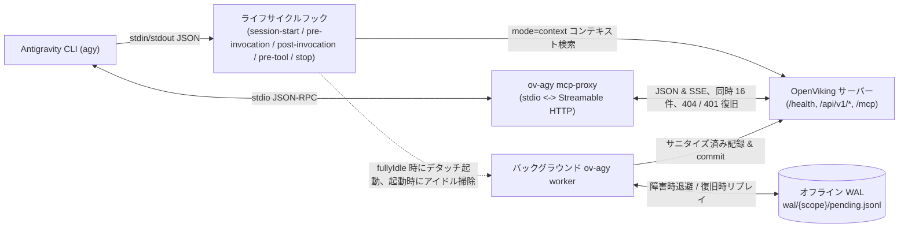

<div align="center">
  
  <h1>agy-openviking</h1>
  <p>Node.js ランタイム不要のシングルバイナリ Rust 製プラグイン。OpenViking の <code>viking://</code> 階層型仮想ファイルシステムと長期メモリを Google Antigravity CLI（<code>agy</code>）へ統合します。</p>

  <p>
    <a href="https://github.com/JamCh01/agy-openviking/actions/workflows/ci.yml"></a>
    <a href="https://github.com/JamCh01/agy-openviking/releases"></a>
    <a href="LICENSE"></a>
    <a href="Cargo.toml"></a>
  </p>

  <p>
    <a href="README.md">English</a> | <a href="README.zh-CN.md">简体中文</a> | <a href="README.zh-TW.md">繁體中文</a> | <strong>日本語</strong>
  </p>
</div>

---

## 目次

- [背景](#背景)
- [アーキテクチャとコンポーネント](#アーキテクチャとコンポーネント)
- [インストール](#インストール)
- [使い方と設定](#使い方と設定)
- [関連プロジェクト](#関連プロジェクト)
- [メンテナとコントリビューション](#メンテナとコントリビューション)
- [ライセンス](#ライセンス)

## 背景

[OpenViking](https://github.com/volcengine/OpenViking) は、エージェントの長期メモリ・チームドキュメント・再利用可能なスキル・コンパイル済みアーキテクチャルールを単一の `viking://` 仮想ファイルシステム上で統合管理し、**L0（要約）-> L1（概要）-> L2（本文）** の段階的なコンテキスト階層を提供します。

`agy-openviking`（`ov-agy`）は、**Node.js や Python ランタイムへの依存が一切ない** ネイティブ Rust シングルバイナリとして、OpenViking を Google Antigravity CLI（`agy`）の 5 つの拡張ピラー（**MCP サーバー + ライフサイクルフック + サブエージェント + スキル + 常駐ルール**）にブリッジします。

- **サブミリ秒の同期高速パスとフェイルオープン（Fail-Open）設計**：高頻度で呼ばれるライフサイクルフック（`PreToolUse` および `Stop`）は非同期ランタイムを起動せず `< 1 ms` で同期実行されます。すべてのフックでネットワークタイムアウトや設定エラーを捕捉し、終了コード `0` と安全なフォールバック JSON を返すため、OpenViking サーバー停止時でも `agy` 本体の動作を決してブロックしません。
- **ユーザーターン単位の重複排除。** 最初のモデル呼び出しで現在の入力とステップを照合します。ツールループ（`invocationNum > 0`）とモデル応答後のバックグラウンド再開では検索を省略します。
- **Git ワークツリー対応のリポジトリ単位 Peer 正規化**：リンクされた Git ワークツリー（`.git` ファイル内の `gitdir:` と `commondir`）から共有 `.git/config` を辿り、SSH（`git@github.com:Org/Repo.git`）と HTTPS（`https://github.com/Org/Repo.git`）の `origin` URL を同一のリポジトリ `peer` ID に正規化します。
- **自己汚染防止キャプチャとオフライン先行書き込みログ（WAL）**：デタッチされたバックグラウンドプロセス `ov-agy worker` が、`<openviking-context>`・`<openviking-session>`・`<available-skills>` タグを除去してから会話ターンを保存します。サーバー障害時は `fs4` ファイルロック付きのオフライン WAL（`wal/<scope>/pending.jsonl`、最大 `10 MiB`）へ退避し、復旧後に自動リプレイします。

## アーキテクチャとコンポーネント

| コンポーネント | エントリポイント / パス | 役割と責務の境界 |
| :--- | :--- | :--- |
| **MCP プロキシ（`mcp-proxy`）** | `ov-agy mcp-proxy`（`mcp_config.json`） | MCP の `roots/list` で agy のワークスペースを特定し、JSON/SSE リクエストを `{base_url}/mcp` に最大 16 件まで同時に転送します。応答は順不同で返ることがありますが、`initialize` と通知は順序を保ちます。セッション期限切れの HTTP 404 で再初期化します。401/403 を受けると `ovcli.conf` と `ov.conf` を再読み込みし、変更されていれば（`ov config switch`、`ov-agy setup`）新しいキーで 1 回だけ再接続します。60 秒のタイムアウトを超えたリクエストには JSON-RPC エラー `-32004` を返します。 |
| **`SessionStart` フック** | `sh ./scripts/ov-agy hook session-start` | 接続を確認し、`<openviking-session>` のステータスブロックと `<openviking-context source="startup">`（ユーザーとプロジェクトのプロフィール、メモリ索引、スキル一覧。`sessionStartMaxBytes` の範囲内）を注入します。アイドル掃除も開始します。 |
| **`PreInvocation` フック** | `sh ./scripts/ov-agy hook pre-invocation` | `lastUserInput` とログから現在のターンを判定し、開発用途のコンテキストを検索します。`transcript_full.jsonl` があれば優先します。`/compact` の後は起動時ブロックを再度注入し（`source="compaction"`）、セッションをコミットします。 |
| **`PostInvocation` フック** | `sh ./scripts/ov-agy hook post-invocation` | ターンの最終回答の後に、そのターンで使った OpenViking のソースを示す行（`OpenViking · 3 sources · 2 memories · 1 read` など）をユーザーにのみ表示します（`usageView`）。モデルには見えません。 |
| **`PreToolUse` フック** | `sh ./scripts/ov-agy hook pre-tool` | パスが `viking://` で始まるローカルファイル操作を拒否します。ファイル本文や検索語では URI を引用できます。それ以外の呼び出しにはすべて `ask` を返し、agy 本来の権限フローに判断を委ねます（agy は decision のない応答を拒否し、`allow` はユーザー自身の権限ルールを迂回してしまうためです）。 |
| **`Stop` フックと背景 `worker`** | `sh ./scripts/ov-agy hook stop` -> `ov-agy worker` | アイドル時に完了したメッセージを 100 件ずつのバッチで `agy-{conversationId}` に送ります。本文はそのまま送り、各ツール呼び出しはその結果と組にして `tool` part にします。サーバーの未コミット token が `commitTokenThreshold` に達したときにコミットし、該当するオフラインキューも再送します。この回の処理は `last-capture.json` に記録されます。 |
| **アイドル掃除** | `ov-agy sweep`（`SessionStart` が起動） | agy には `SessionEnd` がないため、新しいセッションの開始時に、30 分以上アイドル状態の会話をコミットし、オフラインキューを再送し、30 日より古い状態を削除します。 |
| **コマンド** | `scripts/ov-agy doctor` / `status` / `setup` | `doctor` はインストール、設定、サーバー、直近のアクティビティを確認します。`status` はプラグインが現在行っている動作を表示します。`setup` は検証済みの URL とキーを `ovcli.conf` に書き込みます。 |
| **サブエージェント** | `agents/viking-navigator.md` | 読み取り専用のバックグラウンド探索サブエージェント（`inheritMcp: true`、`commandExecutionPolicy: off`）。L0 -> L1 -> L2 の順で `viking://` ツリーを調査し、正確な URI 引用付きの要約だけを親エージェントへ返します。 |
| **スキル群** | `skills/*/SKILL.md` | `openviking-memory`（検索ツールの選択、書き込みのタイミング）、`openviking-skills`（保存済みスキル）、`/ov-doctor`（診断）、`/ov-ingest`（リソースとスキルの取り込み）、`/ov-experience`（知見の検索）、`/ov-rule-search`（コンパイル済みルール）。 |
| **常駐ルール（Rules）** | `rules/openviking-context.md` | フロントマターで `trigger: always_on` を明示。`viking://` 仮想 URI の境界、`viking://~` ホームエイリアス指定、L0 -> L1 -> L2 の段階的取得、ローカルワークスペース優先の原則を常時適用します。 |

agy 1.5.16 の ACP `session/load` は会話履歴を復元し、`SessionStart` の再実行はありません。次の入力で意味検索を行い、保存した位置から会話の記録を再開します。



## インストール

### 前提条件

1. **Google Antigravity CLI（`agy`）** がインストールされていること（macOS または Linux）。Windows は未検証です。フックと MCP サーバーは `sh ./scripts/ov-agy` を起動するため、Git for Windows の `sh` が `PATH` 上にある必要があります（インストール時に「Use Git and optional Unix tools from the Command Prompt」を選択してください）。
2. **OpenViking サーバー** が起動していること（ローカル既定 `http://127.0.0.1:1933` またはリモート HTTPS 環境）。`ov-agy` は rustls で TLS を検証し、同梱の Mozilla ルート証明書と OS の証明書ストア（macOS のキーチェーン、Linux の CA バンドル、Windows の証明書ストア。`SSL_CERT_FILE` / `SSL_CERT_DIR` を設定するとストアの代わりにそれを使います）を信頼します。ストアにないプライベート CA は、`OPENVIKING_CA_CERTS` にその PEM ファイルを指定してください。

### ワンライナーでのリモートインストール

```bash
agy plugin install https://github.com/JamCh01/agy-openviking
```

agy の `/plugin` マーケットプレイスには Google が選定したカタログしか表示されないため、このプラグインは GitHub リポジトリ（または後述のローカルディレクトリ）からインストールします。

ローカルのビルド成果物が存在しない初回起動時、`./scripts/ov-agy` は `.antigravity-plugin/plugin.json` から `version` を自動取得し、独立した `mktemp` 一時ディレクトリに対象プラットフォーム向けの事前ビルド済みバイナリ（`aarch64-apple-darwin`、`x86_64-apple-darwin`、`x86_64-unknown-linux-musl`、`aarch64-unknown-linux-musl`、`x86_64-pc-windows-msvc`）をダウンロードします。`checksums.txt` による **SHA-256** 検証を通過した後、同一ディレクトリ内のアトミックな `mv -f` によって `${PLUGIN_DATA}/bin/ov-agy-v<version>` へ配置されるため、`mcp-proxy` と `SessionStart` が同時にコールドスタートしても競合しません。MCP サーバーの起動時はダウンロード完了を待ちますが、フックは待ちません。`PreToolUse` フックがタイムアウトすると agy はツール呼び出しを失敗扱いにするため、バイナリがキャッシュされるまで各フックは即座に応答し（`PreToolUse` は `ask`、それ以外は `{}`）、バックグラウンドでのダウンロードを 1 回だけ開始します。

### ミラーサーバー・制限付きネットワークでの高速化

社内プロキシ環境や GitHub Releases へのアクセスが制限されている環境では、環境変数 `OPENVIKING_RELEASE_BASE_URL` にミラー先のベース URL（アーカイブと `checksums.txt` の配置先）を指定できます。

```bash
export OPENVIKING_RELEASE_BASE_URL="https://mirror.example.com/JamCh01/agy-openviking/releases/download/v0.2.0"
```

### ソースコードからのローカルビルド（開発向け）

安定版の Rust ツールチェーン（`cargo`、Rust 2021 Edition）が必要です。

```bash
git clone https://github.com/JamCh01/agy-openviking.git
cd agy-openviking
cargo build --release
agy plugin validate --strict .
agy plugin install .
```

プラグインディレクトリ内に `target/release/ov-agy`（または `target/debug/ov-agy`）が存在する場合、`./scripts/ov-agy` はネットワークダウンロードを行わずローカルバイナリを優先実行します。

## 使い方と設定

### クイック設定（`~/.openviking/ovcli.conf`）

プラグインの setup コマンドは URL とキーの入力を求め、サーバーで検証（到達可能か、キーが受理されるか、root キーでないか）してから `~/.openviking/ovcli.conf` にマージします。以前のファイルは `ovcli.conf.bak-<time>` として残し、どちらもパーミッションは 0600 です。

```bash
~/.gemini/config/plugins/openviking/scripts/ov-agy setup
# without prompts, keeping the key out of shell history:
printf '%s\n' "$OV_KEY" | ~/.gemini/config/plugins/openviking/scripts/ov-agy setup --url https://ov.example.com --api-key-stdin --yes
```

`--dry-run` はキーをマスクしたマージ後のファイルを表示し、`--no-verify` はサーバーでの検証を省略します。OpenViking CLI の `ov config` も同じファイルに書き込みます。手動で書く場合は、`~/.openviking/ovcli.conf`（推奨パーミッション `chmod 600`）を作成し、OpenViking サーバーの接続情報を設定します。

```json
{
  "url": "http://127.0.0.1:1933",
  "api_key": "your-user-or-admin-api-key",
  "plugin": {
    "antigravity": {
      "enabled": true
    }
  }
}
```

> [!WARNING]
> **`/mcp` にサーバー側の `server.root_api_key` を使用しないでください**：OpenViking では `ov.conf` の `server.root_api_key` はクラスター管理 API 専用であり、`/mcp` やテナントメモリ API に使用すると `403 Forbidden` で拒否されます。`ov config` で発行した **User Key**（またはテナント **Admin Key**）を設定するか、ローカル `127.0.0.1:1933` の認証なしモードを利用してください。

### スキル・サブエージェント・CLI 診断の使い方

- **`/ov-doctor`（接続・設定セルフチェック）**：`ov-agy doctor` を実行し、ok/info/warn/fail の検出結果を、問題ごとの修正方法を添えて 4 つのセクションで報告します。プラグインのインストール（マニフェスト、フック、ランチャー、MCP エントリ、agy での有効化）、設定（設定ソース、URL の lint、マスク済みキー、root キーのガード、peer、各種スイッチ、プロキシの環境変数、TLS ルート証明書）、サーバー（キーから解決される ID を併記する `/health`、`/ready`、`/api/v1/system/status`、`viking://~/memories` の読み取り、MCP `tools/list`）、直近のアクティビティ（直近の注入、リコールとキャプチャ、オフラインキュー、デバッグログ内のフックエラー）です。人が読む形式のレポートはチェックが失敗すると終了コード 1 で終了し、`--json` は常に終了コード 0 で `ok` を含みます。`ov-agy status` は代わりに 1 画面の要約を表示します。ターミナルからは次のコマンドを実行します。
  ```bash
  ~/.gemini/config/plugins/openviking/scripts/ov-agy doctor
  ~/.gemini/config/plugins/openviking/scripts/ov-agy doctor --json
  ~/.gemini/config/plugins/openviking/scripts/ov-agy status
  ```
- **`openviking-memory` と `openviking-skills`**：Codex・Claude Code プラグインと同様に、モデルが呼び出すスキルです。前者はコンテキスト検索・`find`・リスト検索・`grep` の使い分け、`viking://` URI の読み取り、書き込むべき場面と避けるべき場面、メモリの保存先を扱います。後者は OpenViking に保存されたスキルの検索・利用・作成・共有・移行を扱います。
- **`/ov-ingest`（ドキュメント・スキルの取り込み）**：Web ドキュメント・ローカル仕様書・Git リポジトリを `viking://resources/...` へ取り込む `add_resource` 手順や、`add_skill` によるスキル登録、非同期 L0/L1 インデックス生成タスクの完了確認をガイドします。
- **`/ov-experience`（トラブルシューティング知見の検索）**：`find` または `search` で `viking://~/memories/experiences` を検索し、一致した知見のうち最大 3 件の本文を `read` で読み込みます。`viking://` URI は正規の形のまま渡します。
- **`/ov-rule-search`（アーキテクチャルールの事前確認）**：未知のモジュールや公開 API を変更する前に `rule_search` を実行し、コンパイル済みチームルール（`applies_when` / `exception` 条件）を検証します。返却が不完全（`delivery.complete: false`）で省かれたルールは、作業の前に読み込みます。
- **`viking-navigator` サブエージェントへの委譲**：広範な `viking://` ドキュメント調査を `viking-navigator` に委譲すると、L0 `.abstract.md` と L1 `.overview.md` で候補を絞り込んだ上で必要な L2 本文のみを読み込み、メインコンテキストを消費せずに調査結果を要約します。

### 設定と認証情報の優先順位チェーン

`OPENVIKING_CREDENTIAL_SOURCE=auto`（既定値）の場合、`ov-agy` は優先度の高い順に設定を解決します。

1. **環境変数**（`OPENVIKING_*`）
2. **ワークスペースのローカル上書き設定**：`<repo>/.openviking/config.local.json`
3. **ワークスペースのチーム共有設定**：`<repo>/.openviking/config.json`
4. **OpenViking CLI 設定ファイル**：`~/.openviking/ovcli.conf`（または `OPENVIKING_CLI_CONFIG_FILE`、`plugin.antigravity.*` / `plugin.*` を含む）
5. **OpenViking サーバー設定ファイル**：`~/.openviking/ov.conf`（または `OPENVIKING_CONFIG_FILE`、`server.*` / `antigravity.*` を含む）
6. **組み込みデフォルト値**：`http://127.0.0.1:1933`（設定ファイルが存在せず `OPENVIKING_MEMORY_ENABLED` も未指定の場合、プラグインは自動的に無効化されオーバーヘッドは発生しません）。

リポジトリの `.openviking/config.json` と `.openviking/config.local.json` は誰でもコミットできるため、設定できるのは `peer.{id,source}`、`recall.{enabled,peer_scope,dedup_turns,max_items,score_threshold}`、`capture.{enabled,commit_token_threshold}`、`bypass.session_patterns`、`usage.{view,output}` のみです。`~/.openviking/workspaces/` にある個人用レジストリのエントリは同じキーを設定でき、そのエントリが指すリポジトリでは、上記の 2 つのファイルのどちらよりも優先されます。フィルター、デバッグログ、タイムアウトなどその他の動作設定は個人の設定か環境変数からのみ読み込み、サーバー URL、API キー、アカウント、ユーザーも同様です。無視されたキーは `ov-agy doctor` に一覧表示されます。オフラインキューはこれらの接続情報と peer ごとに分離されます。旧形式の `wal/pending.jsonl` は手動復旧用に保持されます。

### 環境変数リファレンス

| 環境変数 | デフォルト値 | 説明 |
| :--- | :--- | :--- |
| `OPENVIKING_MEMORY_ENABLED` | 自動（設定ファイルの有無） | プラグイン全体の有効・無効スイッチ（`1`/`true`/`yes`/`on` または `0`/`false`/`no`/`off`）。 |
| `OPENVIKING_CREDENTIAL_SOURCE` | `auto` | 認証情報の参照元ポリシー：`auto`、`cli`（設定ファイルのみ）、`env`（環境変数のみ）。 |
| `OPENVIKING_URL` / `OPENVIKING_BASE_URL` | `http://127.0.0.1:1933` | OpenViking HTTP サーバーのベース URL。 |
| `OPENVIKING_MCP_URL` | `{base_url}/mcp` | Streamable HTTP MCP エンドポイント URL の上書き指定。 |
| `OPENVIKING_API_KEY` / `OPENVIKING_BEARER_TOKEN` | *(空)* | User またはテナント Admin の API キー。`Authorization: Bearer` として送信されます。 |
| `OPENVIKING_ACCOUNT` | *(空)* | trusted モードで使うアカウント。`X-OpenViking-Account` として送信されます。 |
| `OPENVIKING_USER` | *(空)* | trusted モードで使うユーザー。`X-OpenViking-User` として送信されます。 |
| `OPENVIKING_AUTH_MODE` | `api_key`（アカウントまたはユーザーを設定した場合は `trusted`） | `trusted` はアカウントとユーザーのヘッダーを送信します。`api_key` ではキーだけで ID が決まります。 |
| `OPENVIKING_EXTRA_HEADERS` | *(空)* | サーバーの手前にあるゲートウェイ（たとえば Cloudflare Access）向けに、追加のリクエストヘッダーを指定する JSON オブジェクト。`Authorization`、`X-API-Key`、`Accept`、`Content-Type` と MCP ヘッダーは上書きできません。 |
| `OPENVIKING_CA_CERTS` | *(空)* | 追加で信頼する CA 証明書の PEM バンドル。同梱の Mozilla ルート証明書と OS の証明書ストアに加えて使われます。`ovcli.conf` の `plugin.antigravity` ブロックの `caCerts` でも指定でき、未設定なら Node 版 OpenViking プラグインが読む `NODE_EXTRA_CA_CERTS` を使います。リポジトリ内の設定ファイルからは指定できません。 |
| `OPENVIKING_PEER_ID` | 自動（Git リモートまたはディレクトリ名） | `X-OpenViking-Actor-Peer` リポジトリ Peer ID の明示的な上書き。 |
| `OPENVIKING_PEER_SOURCE` | `git` | peer ID が未設定のときに peer を導出する方法：`git`（`origin` リモート、なければリポジトリのルート）、`cwd`、`none`、または `{git_remote}`・`{git_root}`・`{cwd}`・`{dir}`・`{harness}` を使えるテンプレート。 |
| `OPENVIKING_HOME` | `~/.openviking` | OpenViking の設定・ログ用ベースディレクトリ。 |
| `OPENVIKING_CLI_CONFIG_FILE` | `~/.openviking/ovcli.conf` | `ovcli.conf` 設定ファイルのパス上書き。 |
| `OPENVIKING_CONFIG_FILE` | `~/.openviking/ov.conf` | `ov.conf` 設定ファイルのパス上書き。 |
| `OPENVIKING_PLUGIN_DATA` / `OPENVIKING_STATE_DIR` | `~/.openviking/agy-plugin` | ターン状態・ロック・オフライン `wal/<scope>/pending.jsonl`・キャッシュ済みバイナリの保存先。 |
| `OPENVIKING_TIMEOUT_MS` | `15000` | HTTP リクエストタイムアウト（ミリ秒、`500`–`300000`）。 |
| `OPENVIKING_AUTO_RECALL` | `true` | `PreInvocation` での自動コンテキスト検索を有効化。 |
| `OPENVIKING_AUTO_CAPTURE` | `true` | `Stop` でのバックグラウンド会話キャプチャと、`SessionStart` 時のアイドル掃除を有効化。 |
| `OPENVIKING_RECALL_LIMIT` | サーバー設定 | 明示した値（1–50）を開発用の 6 分類に配分し、各分類に最低 1 枠を割り当てます。旧 find の既定値は 6 件です。 |
| `OPENVIKING_RECALL_MAX_TOKENS` | サーバー設定 | コンテキスト検索のトークン予算（64–32000）。 |
| `OPENVIKING_RECALL_REWRITE` | 無効 | サーバーの書き換えを使う場合は `server` または `auto`。書き換えには数十秒のリコール予算が必要です。 |
| `OPENVIKING_RECALL_TIMEOUT_MS` | `3800` | `PreInvocation` でのリコール要求の時間予算（`1000`–`25000`）。新しいプロンプトのたびに待つため、サーバーが遅い場合にのみ増やしてください。 |
| `OPENVIKING_RECALL_QUERY_EXPANSION` | 予算 10 秒未満では `off` | `auto` または `off`。短い予算ではサーバーのクエリ拡張が終わらないため、モードを指定するか予算を 10 秒以上にしない限り `off` を送ります。 |
| `OPENVIKING_NO_AUTO_INJECT` | `false` | 起動時ブロック（プロフィール、メモリ索引、スキル一覧）を省略します。プロンプトごとの検索は有効なままです。 |
| `OPENVIKING_PROFILE_TOKEN_BUDGET` | `10000` | 起動時のプロフィールとメモリ索引に使うトークン数（`500`–`50000`）。 |
| `OPENVIKING_SKILL_CATALOG` | `true` | 起動時ブロックに `<available-skills>` のスキル一覧を含めます。 |
| `OPENVIKING_SKILL_CATALOG_TOKEN_BUDGET` | `1200` | スキル一覧に使うトークン数。説明が収まらない場合は名前のみにします。 |
| `OPENVIKING_SESSION_START_MAX_BYTES` | `9500` | 起動時ブロックの UTF-8 バイト数の上限。プロフィール、メモリ索引、スキル一覧のトークン予算を約 4 バイト/トークンで上限内に収まるよう縮めるため、メモリが多いと索引は「+N more」付きで短くなります。それでも推定が上限を超えた場合に限り、メモリ索引、スキル一覧の順に省かれます。 |
| `OPENVIKING_RECALL_DEDUP_TURNS` | `5` | サーバー側のターン間重複排除ウィンドウ（`0`–`20`）。 |
| `OPENVIKING_SCORE_THRESHOLD` | `0.35` | 検索ヒットの最小スコア閾値（`0.0`–`1.0`）。 |
| `OPENVIKING_MIN_QUERY_LENGTH` | `3` | コンテキスト検索を発火させる最小プロンプト文字数（`1`–`64`）。 |
| `OPENVIKING_RECALL_PEER_SCOPE` | `all` | 検索時の Peer スコープ：`all` または `actor`。 |
| `OPENVIKING_RECALL_EXCLUDE_URIS` | *(空)* | 検索結果から除外する `viking://` URI プレフィックス（カンマ区切りまたは JSON 配列）。 |
| `OPENVIKING_RECALL_QUERY_FILTERS` | *(空)* | 検索前にクエリ文字列へ適用する `sed` 形式（`s/pat/rep/g`、`d/pat/`、`k/pat/`）または正規表現フィルタ。 |
| `OPENVIKING_CAPTURE_FILTERS` | *(空)* | キャプチャ前に適用するマスク・除外フィルタ（`user:` / `assistant:` プレフィックス対応）。 |
| `OPENVIKING_CAPTURE_TOOL_CALLS` | `true` | ツール呼び出しとその結果（ファイル読み込み、コマンド、MCP 呼び出し）を `tool` part としてキャプチャします。`false` で会話本文のみ送ります。 |
| `OPENVIKING_CAPTURE_TOOL_MAX_CHARS` | `1000000` | 異常に大きいツール出力に対する上限（`200`–`1000000`）。大きな出力はサーバー側で外部化されます。上限を超える値は先頭と末尾を残し、その間を省略マーカーに置き換えます。 |
| `OPENVIKING_COMMIT_TOKEN_THRESHOLD` | `20000` | セッションの未コミット token がこの値に達したらコミットします（`1000`–`1000000`）。Codex・Claude Code プラグインと同じ動作です。リポジトリでは `capture.commit_token_threshold` を設定できます。 |
| `OPENVIKING_COMMIT_EVERY_TURNS` | *(未設定)* | 任意の追加条件：未コミットのメッセージがこの件数に達したときもコミットします（`1`–`1000`）。 |
| `OPENVIKING_AGY_IDLE_TTL_MS` | `1800000` | agy には `SessionEnd` がないため、次の `SessionStart` がこの時間以上アイドルな会話をコミットします（掃除は 10 分に 1 回まで）。 |
| `OPENVIKING_IDLE_SWEEP` | `true` | `false` にすると `SessionStart` からのアイドル掃除を止めます。 |
| `OPENVIKING_AUTO_COMMIT_ON_COMPACT` | `true` | agy が会話を圧縮（compact）したときに、セッションをコミットします。 |
| `OPENVIKING_RESUME_ARCHIVE_INJECT` | `false` | `/compact` の後に注入するコンテキストへ、最新のセッションアーカイブの概要を追加します。 |
| `OPENVIKING_RESUME_ARCHIVE_TOKEN_BUDGET` / `OPENVIKING_RESUME_ARCHIVE_MAX_CHARS` | `32000` / `6000` | そのアーカイブ概要のサイズ上限。 |
| `OPENVIKING_USAGE_VIEW` | `summary` | 回答ごとのソース行：`summary`、`expanded`（ソースごとに 1 行）、`off`。 |
| `OPENVIKING_USAGE_OUTPUT` | `notice` | `notice` はその行をユーザーにのみ表示します。`footer` はモデルに、回答の末尾へ使ったソースを書くよう依頼します。 |
| `OPENVIKING_BYPASS_SESSION` | `false` | すべてのフックがサーバーへの通信をスキップします。 |
| `OPENVIKING_BYPASS_SESSION_PATTERNS` | *(空)* | カンマ区切りの glob（`**` は `/` をまたいで一致します）。会話 ID、`agy-<id>`、ワークスペースのパスと照合し、一致するとリコールとキャプチャをスキップします。 |
| `OPENVIKING_PENDING_TTL_DAYS` / `OPENVIKING_PENDING_MAX_RETRIES` | `7` / `50` | オフラインキューのエントリは、この日数より古くなるか、この回数だけ再試行されると破棄されます。 |
| `OPENVIKING_DEBUG` | `false` | 有効時、`OPENVIKING_DEBUG_LOG` へ JSONL 診断ログを追記（`stdout` には一切出力しません）。 |
| `OPENVIKING_DEBUG_LOG` | `~/.openviking/logs/agy.jsonl` | デバッグ有効時の JSONL ログファイル出力先。 |
| `OPENVIKING_RELEASE_BASE_URL` | GitHub Releases URL | `scripts/fetch-binary.sh` が事前ビルド済みバイナリを取得する際のカスタム URL プレフィックス。 |

## 関連プロジェクト

- [volcengine/OpenViking](https://github.com/volcengine/OpenViking) — `viking://` L0/L1/L2 仮想ファイルシステム・セッションメモリ抽出・Streamable HTTP MCP サーバーを提供する AI エージェント向けオープンソースコンテキストデータベース。
- [Google Antigravity ドキュメント](https://antigravity.google/docs) — Antigravity CLI（`agy`）のプラグイン・ライフサイクルフック・MCP サーバー・サブエージェント・スキル・ルールの公式ドキュメント。
- [ワイヤプロトコル仕様書](docs/WIRE_CONTRACT.md) — `ov-agy` が実装している OpenViking REST・Streamable HTTP MCP・Antigravity フック JSON 入出力仕様の詳細。

## メンテナとコントリビューション

メンテナ：[@JamCh01](https://github.com/JamCh01)。バグ報告や機能提案、Pull Request は [JamCh01/agy-openviking](https://github.com/JamCh01/agy-openviking/issues) までお寄せください。

Pull Request を作成する前に、ローカルで以下の検証コマンドがすべて通過することを確認してください。

```bash
cargo fmt --check
cargo clippy --all-targets -- -D warnings
cargo test
agy plugin validate --strict .
```

Rust コードは [Google Rust Style Guide](https://google.github.io/styleguide/rustguide.html)、コミットメッセージは [Angular Commit Message Guidelines](https://github.com/angular/angular/blob/main/contributing-docs/commit-message-guidelines.md) に準拠しています。

## ライセンス

本リポジトリは [Apache License, Version 2.0](LICENSE) の下で公開されています。

`agy-openviking`（`ov-agy`）は独立したクリーンルーム実装の外部クライアントであり、公開仕様としてドキュメント化された HTTP REST（`/health`、`/api/v1/*`）および Streamable HTTP MCP（`/mcp`）プロトコルのみを介して OpenViking サーバーと通信します。サーバー内部のソースコードのリンクや再配布は一切行っていません。
