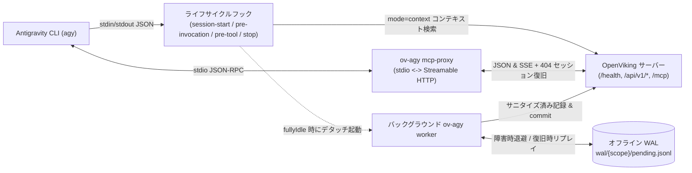

<div align="center">
  
  <h1>agy-openviking</h1>
  <p>Node.js ランタイム不要のシングルバイナリ Rust 製プラグイン。OpenViking の <code>viking://</code> 階層型仮想ファイルシステムと長期メモリを Google Antigravity CLI（<code>agy</code>）へ統合します。</p>

  <p>
    <a href="https://github.com/JamCh01/agy-openviking/actions/workflows/ci.yml"></a>
    <a href="https://github.com/JamCh01/agy-openviking/releases"></a>
    <a href="LICENSE"></a>
    <a href="Cargo.toml"></a>
  </p>

  <p>
    <a href="README.md">English</a> | <a href="README.zh-CN.md">简体中文</a> | <a href="README.zh-TW.md">繁體中文</a> | <strong>日本語</strong>
  </p>
</div>

---

## 目次

- [背景](#背景)
- [アーキテクチャとコンポーネント](#アーキテクチャとコンポーネント)
- [インストール](#インストール)
- [使い方と設定](#使い方と設定)
- [関連プロジェクト](#関連プロジェクト)
- [メンテナとコントリビューション](#メンテナとコントリビューション)
- [ライセンス](#ライセンス)

## 背景

[OpenViking](https://github.com/volcengine/OpenViking) は、エージェントの長期メモリ・チームドキュメント・再利用可能なスキル・コンパイル済みアーキテクチャルールを単一の `viking://` 仮想ファイルシステム上で統合管理し、**L0（要約）-> L1（概要）-> L2（本文）** の段階的なコンテキスト階層を提供します。

`agy-openviking`（`ov-agy`）は、**Node.js や Python ランタイムへの依存が一切ない** ネイティブ Rust シングルバイナリとして、OpenViking を Google Antigravity CLI（`agy`）の 5 つの拡張ピラー（**MCP サーバー + ライフサイクルフック + サブエージェント + スキル + 常駐ルール**）にブリッジします。

- **サブミリ秒の同期高速パスとフェイルオープン（Fail-Open）設計**：高頻度で呼ばれるライフサイクルフック（`PreToolUse` および `Stop`）は非同期ランタイムを起動せず `< 1 ms` で同期実行されます。すべてのフックでネットワークタイムアウトや設定エラーを捕捉し、終了コード `0` と安全なフォールバック JSON を返すため、OpenViking サーバー停止時でも `agy` 本体の動作を決してブロックしません。
- **ユーザーターン単位の重複排除。** 最初のモデル呼び出しで現在の入力とステップを照合します。ツールループ（`invocationNum > 0`）とモデル応答後のバックグラウンド再開では検索を省略します。
- **Git ワークツリー対応のリポジトリ単位 Peer 正規化**：リンクされた Git ワークツリー（`.git` ファイル内の `gitdir:` と `commondir`）から共有 `.git/config` を辿り、SSH（`git@github.com:Org/Repo.git`）と HTTPS（`https://github.com/Org/Repo.git`）の `origin` URL を同一のリポジトリ `peer` ID に正規化します。
- **自己汚染防止キャプチャとオフライン先行書き込みログ（WAL）**：デタッチされたバックグラウンドプロセス `ov-agy worker` が、`<openviking-context>`・`<openviking-session>`・`<available-skills>` タグを除去してから会話ターンを保存します。サーバー障害時は `fs4` ファイルロック付きのオフライン WAL（`wal/<scope>/pending.jsonl`、最大 `10 MiB`）へ退避し、復旧後に自動リプレイします。

## アーキテクチャとコンポーネント

| コンポーネント | エントリポイント / パス | 役割と責務の境界 |
| :--- | :--- | :--- |
| **MCP プロキシ（`mcp-proxy`）** | `ov-agy mcp-proxy`（`mcp_config.json`） | MCP の `roots/list` で agy のワークスペースを特定し、JSON/SSE リクエストを `{base_url}/mcp` に転送します。セッション期限切れの HTTP 404 で再初期化します。 |
| **`SessionStart` フック** | `./scripts/ov-agy hook session-start` | 接続を確認し、ユーザーとプロジェクトのプロフィール、設定・エンティティの索引、スキル一覧、既存のセッションアーカイブの概要を注入します。 |
| **`PreInvocation` フック** | `./scripts/ov-agy hook pre-invocation` | `lastUserInput` とログから現在のターンを判定し、開発用途のコンテキストを検索します。`transcript_full.jsonl` があれば優先します。 |
| **`PreToolUse` フック** | `./scripts/ov-agy hook pre-tool` | パスが `viking://` で始まるローカルファイル操作を拒否します。ファイル本文や検索語では URI を引用できます。 |
| **`Stop` フックと背景 `worker`** | `./scripts/ov-agy hook stop` -> `ov-agy worker` | アイドル時に完了したメッセージを `agy-{conversationId}` に送り、残りのバッチをコミットして該当するオフラインキューを再送します。 |
| **サブエージェント** | `agents/viking-navigator.md` | 読み取り専用のバックグラウンド探索サブエージェント（`inheritMcp: true`、`commandExecutionPolicy: off`）。L0 -> L1 -> L2 の順で `viking://` ツリーを調査し、正確な URI 引用付きの要約だけを親エージェントへ返します。 |
| **スキル群（`/ov-*`）** | `skills/*/SKILL.md` | `/ov-doctor`（接続・認証・WAL 診断）、`/ov-ingest`（ドキュメント・リポジトリ・スキルの取り込み手順）、`/ov-experience`（テレメトリを維持したトラブルシューティング知見検索）、`/ov-rule-search`（変更前のコンパイル済みアーキテクチャルール検索）。 |
| **常駐ルール（Rules）** | `rules/openviking-context.md` | フロントマターで `trigger: always_on` を明示。`viking://` 仮想 URI の境界、`viking://~` ホームエイリアス指定、L0 -> L1 -> L2 の段階的取得、ローカルワークスペース優先の原則を常時適用します。 |

agy 1.5.16 の ACP `session/load` は会話履歴を復元し、`SessionStart` の再実行はありません。次の入力で意味検索を行い、保存した位置から会話の記録を再開します。



## インストール

### 前提条件

1. **Google Antigravity CLI（`agy`）** がインストールされていること（macOS / Linux / Windows 対応）。
2. **OpenViking サーバー** が起動していること（ローカル既定 `http://127.0.0.1:1933` またはリモート HTTPS 環境）。

### ワンライナーでのリモートインストール

```bash
agy plugin install https://github.com/JamCh01/agy-openviking
```

ローカルのビルド成果物が存在しない初回起動時、`./scripts/ov-agy` は `.antigravity-plugin/plugin.json` から `version` を自動取得し、独立した `mktemp` 一時ディレクトリに対象プラットフォーム向けの事前ビルド済みバイナリ（`aarch64-apple-darwin`、`x86_64-apple-darwin`、`x86_64-unknown-linux-musl`、`aarch64-unknown-linux-musl`、`x86_64-pc-windows-msvc`）をダウンロードします。`checksums.txt` による **SHA-256** 検証を通過した後、同一ディレクトリ内のアトミックな `mv -f` によって `${PLUGIN_DATA}/bin/ov-agy-v<version>` へ配置されるため、`mcp-proxy` と `SessionStart` が同時にコールドスタートしても競合しません。

### ミラーサーバー・制限付きネットワークでの高速化

社内プロキシ環境や GitHub Releases へのアクセスが制限されている環境では、環境変数 `OPENVIKING_RELEASE_BASE_URL` にミラー先のベース URL（アーカイブと `checksums.txt` の配置先）を指定できます。

```bash
export OPENVIKING_RELEASE_BASE_URL="https://mirror.example.com/JamCh01/agy-openviking/releases/download/v0.1.2"
```

### ソースコードからのローカルビルド（開発向け）

安定版の Rust ツールチェーン（`cargo`、Rust 2021 Edition）が必要です。

```bash
git clone https://github.com/JamCh01/agy-openviking.git
cd agy-openviking
cargo build --release
agy plugin validate --strict .
agy plugin install .
```

プラグインディレクトリ内に `target/release/ov-agy`（または `target/debug/ov-agy`）が存在する場合、`./scripts/ov-agy` はネットワークダウンロードを行わずローカルバイナリを優先実行します。

## 使い方と設定

### クイック設定（`~/.openviking/ovcli.conf`）

`~/.openviking/ovcli.conf`（推奨パーミッション `chmod 600`）を作成し、OpenViking サーバーの接続情報を設定します。

```json
{
  "url": "http://127.0.0.1:1933",
  "api_key": "your-user-or-admin-api-key",
  "plugin": {
    "antigravity": {
      "enabled": true
    }
  }
}
```

> [!WARNING]
> **`/mcp` にサーバー側の `server.root_api_key` を使用しないでください**：OpenViking では `ov.conf` の `server.root_api_key` はクラスター管理 API 専用であり、`/mcp` やテナントメモリ API に使用すると `403 Forbidden` で拒否されます。`ov config` で発行した **User Key**（またはテナント **Admin Key**）を設定するか、ローカル `127.0.0.1:1933` の認証なしモードを利用してください。

### スキル・サブエージェント・CLI 診断の使い方

- **`/ov-doctor`（接続・設定セルフチェック）**：有効な設定レイヤー、マスク済み API キー、Root Key `403` 設定ミス警告、`/health` レイテンシ、`/mcp` ハンドシェイク、Git `peer` 正規化 ID、オフライン WAL の未送信件数を一括診断します。ターミナルから直接実行することも可能です。
  ```bash
  ./scripts/ov-agy doctor
  ./scripts/ov-agy doctor --json
  ```
- **`/ov-ingest`（ドキュメント・スキルの取り込み）**：Web ドキュメント・ローカル仕様書・Git リポジトリを `viking://resources/...` へ取り込む `add_resource` 手順や、`add_skill` によるスキル登録、非同期 L0/L1 インデックス生成タスクの完了確認をガイドします。
- **`/ov-experience`（トラブルシューティング知見の検索）**：障害対応やビルドエラー調査時に `search_experience` と `read_experience` を正規の `viking://` URI のまま呼び出し、OpenViking 側の参照テレメトリを正確に記録します。
- **`/ov-rule-search`（アーキテクチャルールの事前確認）**：未知のモジュールや公開 API を変更する前に `rule_search` を実行し、コンパイル済みチームルール（`applies_when` / `exception` 条件）を検証します。
- **`viking-navigator` サブエージェントへの委譲**：広範な `viking://` ドキュメント調査を `viking-navigator` に委譲すると、L0 `.abstract.md` と L1 `.overview.md` で候補を絞り込んだ上で必要な L2 本文のみを読み込み、メインコンテキストを消費せずに調査結果を要約します。

### 設定と認証情報の優先順位チェーン

`OPENVIKING_CREDENTIAL_SOURCE=auto`（既定値）の場合、`ov-agy` は優先度の高い順に設定を解決します。

1. **環境変数**（`OPENVIKING_*`）
2. **ワークスペースのローカル上書き設定**：`<repo>/.openviking/config.local.json`
3. **ワークスペースのチーム共有設定**：`<repo>/.openviking/config.json`
4. **OpenViking CLI 設定ファイル**：`~/.openviking/ovcli.conf`（または `OPENVIKING_CLI_CONFIG_FILE`、`plugin.antigravity.*` / `plugin.*` を含む）
5. **OpenViking サーバー設定ファイル**：`~/.openviking/ov.conf`（または `OPENVIKING_CONFIG_FILE`、`server.*` / `antigravity.*` を含む）
6. **組み込みデフォルト値**：`http://127.0.0.1:1933`（設定ファイルが存在せず `OPENVIKING_MEMORY_ENABLED` も未指定の場合、プラグインは自動的に無効化されオーバーヘッドは発生しません）。

ワークスペースの設定ファイルでは peer とプラグインの動作を指定できます。サーバー URL、API キー、アカウント、ユーザーは個人の設定か環境変数で指定します。オフラインキューはこれらの接続情報と peer ごとに分離されます。旧形式の `wal/pending.jsonl` は手動復旧用に保持されます。

### 環境変数リファレンス

| 環境変数 | デフォルト値 | 説明 |
| :--- | :--- | :--- |
| `OPENVIKING_MEMORY_ENABLED` | 自動（設定ファイルの有無） | プラグイン全体の有効・無効スイッチ（`1`/`true`/`yes`/`on` または `0`/`false`/`no`/`off`）。 |
| `OPENVIKING_CREDENTIAL_SOURCE` | `auto` | 認証情報の参照元ポリシー：`auto`、`cli`（設定ファイルのみ）、`env`（環境変数のみ）。 |
| `OPENVIKING_URL` / `OPENVIKING_BASE_URL` | `http://127.0.0.1:1933` | OpenViking HTTP サーバーのベース URL。 |
| `OPENVIKING_MCP_URL` | `{base_url}/mcp` | Streamable HTTP MCP エンドポイント URL の上書き指定。 |
| `OPENVIKING_API_KEY` / `OPENVIKING_BEARER_TOKEN` | *(空)* | User またはテナント Admin の API キー（`Authorization: Bearer` と `X-API-Key` に付与）。 |
| `OPENVIKING_ACCOUNT` | *(空)* | `X-OpenViking-Account` ヘッダーの明示的な上書き。 |
| `OPENVIKING_USER` | *(空)* | `X-OpenViking-User` ヘッダーの明示的な上書き。 |
| `OPENVIKING_PEER_ID` | 自動（Git リモートまたはディレクトリ名） | `X-OpenViking-Actor-Peer` リポジトリ Peer ID の明示的な上書き。 |
| `OPENVIKING_HOME` | `~/.openviking` | OpenViking の設定・ログ用ベースディレクトリ。 |
| `OPENVIKING_CLI_CONFIG_FILE` | `~/.openviking/ovcli.conf` | `ovcli.conf` 設定ファイルのパス上書き。 |
| `OPENVIKING_CONFIG_FILE` | `~/.openviking/ov.conf` | `ov.conf` 設定ファイルのパス上書き。 |
| `OPENVIKING_PLUGIN_DATA` / `OPENVIKING_STATE_DIR` | `~/.openviking/agy-plugin` | ターン状態・ロック・オフライン `wal/<scope>/pending.jsonl`・キャッシュ済みバイナリの保存先。 |
| `OPENVIKING_TIMEOUT_MS` | `15000` | HTTP リクエストタイムアウト（ミリ秒、`500`–`300000`）。 |
| `OPENVIKING_AUTO_RECALL` | `true` | `PreInvocation` での自動コンテキスト検索を有効化。 |
| `OPENVIKING_AUTO_CAPTURE` | `true` | `Stop` でのバックグラウンド会話キャプチャと自動コミットを有効化。 |
| `OPENVIKING_RECALL_LIMIT` | サーバー設定 | 明示した値（1–50）を開発用の 6 分類に配分し、各分類に最低 1 枠を割り当てます。旧 find の既定値は 6 件です。 |
| `OPENVIKING_RECALL_MAX_TOKENS` | サーバー設定 | コンテキスト検索のトークン予算（64–32000）。 |
| `OPENVIKING_RECALL_REWRITE` | 無効 | フックの制限時間内でサーバーの書き換えを使う場合は `server` または `auto`。 |
| `OPENVIKING_NO_AUTO_INJECT` | `false` | 起動時のプロフィール、索引、スキル一覧を省略します。アーカイブ概要とターンごとの検索は引き続き使えます。 |
| `OPENVIKING_RECALL_DEDUP_TURNS` | `5` | サーバー側のターン間重複排除ウィンドウ（`0`–`20`）。 |
| `OPENVIKING_SCORE_THRESHOLD` | `0.35` | 検索ヒットの最小スコア閾値（`0.0`–`1.0`）。 |
| `OPENVIKING_MIN_QUERY_LENGTH` | `3` | コンテキスト検索を発火させる最小プロンプト文字数（`1`–`64`）。 |
| `OPENVIKING_RECALL_PEER_SCOPE` | `all` | 検索時の Peer スコープ：`all` または `actor`。 |
| `OPENVIKING_RECALL_EXCLUDE_URIS` | *(空)* | 検索結果から除外する `viking://` URI プレフィックス（カンマ区切りまたは JSON 配列）。 |
| `OPENVIKING_RECALL_QUERY_FILTERS` | *(空)* | 検索前にクエリ文字列へ適用する `sed` 形式（`s/pat/rep/g`、`d/pat/`、`k/pat/`）または正規表現フィルタ。 |
| `OPENVIKING_CAPTURE_FILTERS` | *(空)* | キャプチャ前に適用するマスク・除外フィルタ（`user:` / `assistant:` プレフィックス対応）。 |
| `OPENVIKING_CAPTURE_MAX_LENGTH` | `24000` | キャプチャする 1 メッセージあたりの最大文字数（`200`–`100000`）。 |
| `OPENVIKING_COMMIT_EVERY_TURNS` | `6` | バッチ内のコミット間隔（1–1000）。アイドル時には残りのメッセージもコミットします。 |
| `OPENVIKING_DEBUG` | `false` | 有効時、`OPENVIKING_DEBUG_LOG` へ JSONL 診断ログを追記（`stdout` には一切出力しません）。 |
| `OPENVIKING_DEBUG_LOG` | `~/.openviking/logs/agy.jsonl` | デバッグ有効時の JSONL ログファイル出力先。 |
| `OPENVIKING_RELEASE_BASE_URL` | GitHub Releases URL | `scripts/fetch-binary.sh` が事前ビルド済みバイナリを取得する際のカスタム URL プレフィックス。 |

## 関連プロジェクト

- [volcengine/OpenViking](https://github.com/volcengine/OpenViking) — `viking://` L0/L1/L2 仮想ファイルシステム・セッションメモリ抽出・Streamable HTTP MCP サーバーを提供する AI エージェント向けオープンソースコンテキストデータベース。
- [Google Antigravity ドキュメント](https://antigravity.google/docs) — Antigravity CLI（`agy`）のプラグイン・ライフサイクルフック・MCP サーバー・サブエージェント・スキル・ルールの公式ドキュメント。
- [ワイヤプロトコル仕様書](docs/WIRE_CONTRACT.md) — `ov-agy` が実装している OpenViking REST・Streamable HTTP MCP・Antigravity フック JSON 入出力仕様の詳細。

## メンテナとコントリビューション

メンテナ：[@JamCh01](https://github.com/JamCh01)。バグ報告や機能提案、Pull Request は [JamCh01/agy-openviking](https://github.com/JamCh01/agy-openviking/issues) までお寄せください。

Pull Request を作成する前に、ローカルで以下の検証コマンドがすべて通過することを確認してください。

```bash
cargo fmt --check
cargo clippy --all-targets -- -D warnings
cargo test
agy plugin validate --strict .
```

Rust コードは [Google Rust Style Guide](https://google.github.io/styleguide/rustguide.html)、コミットメッセージは [Angular Commit Message Guidelines](https://github.com/angular/angular/blob/main/contributing-docs/commit-message-guidelines.md) に準拠しています。

## ライセンス

本リポジトリは [Apache License, Version 2.0](LICENSE) の下で公開されています。

`agy-openviking`（`ov-agy`）は独立したクリーンルーム実装の外部クライアントであり、公開仕様としてドキュメント化された HTTP REST（`/health`、`/api/v1/*`）および Streamable HTTP MCP（`/mcp`）プロトコルのみを介して OpenViking サーバーと通信します。サーバー内部のソースコードのリンクや再配布は一切行っていません。
