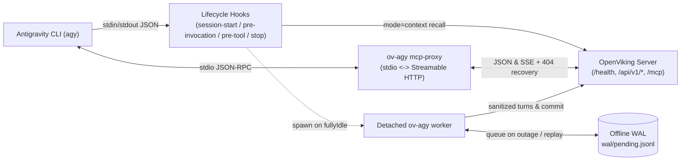

<div align="center">
  
  <h1>agy-openviking</h1>
  <p>Zero-Node-dependency Rust plugin bridging OpenViking's <code>viking://</code> hierarchical context filesystem and long-term memory into Google Antigravity CLI (<code>agy</code>).</p>

  <p>
    <a href="https://github.com/JamCh01/agy-openviking/actions/workflows/ci.yml"></a>
    <a href="https://github.com/JamCh01/agy-openviking/releases"></a>
    <a href="LICENSE"></a>
    <a href="Cargo.toml"></a>
  </p>

  <p>
    <strong>English</strong> | <a href="README.zh-CN.md">简体中文</a> | <a href="README.zh-TW.md">繁體中文</a> | <a href="README.ja.md">日本語</a>
  </p>
</div>

---

## Table of Contents

- [Background](#background)
- [Architecture and Components](#architecture-and-components)
- [Install](#install)
- [Usage and Configuration](#usage-and-configuration)
- [Related Efforts](#related-efforts)
- [Maintainers and Contributing](#maintainers-and-contributing)
- [License](#license)

## Background

[OpenViking](https://github.com/volcengine/OpenViking) organizes agent memories, team documentation, reusable skills, and compiled architectural rules inside a unified `viking://` virtual filesystem with progressive **L0 (abstract) -> L1 (overview) -> L2 (full body)** context tiers.

`agy-openviking` (`ov-agy`) integrates OpenViking into all five customization pillars of Google Antigravity CLI (`agy`)—**MCP Server, Lifecycle Hooks, Subagent, Skills, and Rules**—as a single native Rust binary with **zero Node.js or Python runtime dependencies**:

- **Sub-Millisecond Fast Path & Fail-Open Safety**: Hot-path hooks (`PreToolUse` and `Stop`) execute synchronously in `< 1 ms` without initializing an async runtime. Every hook catches network timeouts and configuration errors, emitting safe fallback JSON with exit code `0` so `agy` never stalls when OpenViking is offline.
- **Prompt-Cache-Safe Turn Deduplication**: `PreInvocation` seeks only the trailing `64 KiB` of `transcript.jsonl` and hashes `(conversationId, turn_offset, query)`, executing `mode: "context"` recall once per user turn while emitting `{}` with zero network I/O on inner tool-call iterations (`invocationNum > 1`).
- **Git Worktree Peer Normalization**: Resolves linked `.git` worktree pointers (`gitdir:` + `commondir`) back to the shared `.git/config`, normalizing SSH (`git@github.com:Org/Repo.git`) and HTTPS (`https://github.com/Org/Repo.git`) remotes into an identical repository `peer` identifier.
- **Anti-Poisoning Capture & Offline WAL**: Strips injected `<openviking-context>`, `<openviking-session>`, and `<available-skills>` blocks before archiving conversation turns in a detached background worker, buffering unsent payloads in an `fs4`-locked JSONL Write-Ahead Log (`wal/pending.jsonl`, up to `10 MiB`) during server outages.

## Architecture and Components

| Component | Entrypoint / File | Responsibility |
| :--- | :--- | :--- |
| **MCP Proxy** | `ov-agy mcp-proxy` (`mcp_config.json`) | Bridges stdio JSON-RPC 2.0 to Streamable HTTP `POST {base_url}/mcp` across both `application/json` and `text/event-stream` (SSE), transparently re-initializing expired `mcp-session-id` sessions on HTTP `404`. |
| **`SessionStart` Hook** | `./scripts/ov-agy hook session-start` | Probes `/health` and `/api/v1/system/status`, discovers remote skills under `viking://~/skills` and `viking://agent/skills`, and injects session status once at startup. |
| **`PreInvocation` Hook** | `./scripts/ov-agy hook pre-invocation` | Extracts the active user turn from the tail of `transcript.jsonl`, deduplicates inner tool-loop calls, and injects `<openviking-context>` via `POST /api/v1/search/search` (`mode: "context"`). |
| **`PreToolUse` Hook** | `./scripts/ov-agy hook pre-tool` | Synchronous `< 1 ms` guard preventing `viking://` virtual URIs from leaking into local filesystem tools (`view_file`, `write_to_file`, `replace_file_content`, `multi_replace_file_content`, `list_dir`, `grep_search`). |
| **`Stop` Hook & Worker** | `./scripts/ov-agy hook stop` -> `ov-agy worker` | Spawns `ov-agy worker` detached (`Stdio::null()`) when `fullyIdle == true`; sanitizes injected XML tags, appends turns to `agy-{conversationId}`, triggers periodic `/commit`, and replays `wal/pending.jsonl`. |
| **Subagent** | `agents/viking-navigator.md` | Read-only background subagent (`inheritMcp: true`, `commandExecutionPolicy: off`) performing progressive L0 -> L1 -> L2 exploration of `viking://` trees without bloating the main context window. |
| **Skills (`/ov-*`)** | `skills/*/SKILL.md` | `/ov-doctor` (connectivity & WAL diagnostics), `/ov-ingest` (resource/skill ingestion SOP), `/ov-experience` (telemetry-preserving troubleshooting recall), and `/ov-rule-search` (compiled architectural compliance search). |
| **Always-On Rule** | `rules/openviking-context.md` | Enforces `viking://` virtual URI boundaries, `viking://~` home-alias addressing, L0 -> L1 -> L2 progressive retrieval, and live workspace provenance priority (`trigger: always_on`). |



## Install

### Prerequisites

1. **Google Antigravity CLI (`agy`)** installed on macOS, Linux, or Windows.
2. **OpenViking Server** running locally (`http://127.0.0.1:1933`) or reachable over HTTPS.

### One-Line Remote Install

```bash
agy plugin install https://github.com/JamCh01/agy-openviking
```

On the first invocation when no local Cargo build is present, `./scripts/ov-agy` reads the exact plugin `version` from `.antigravity-plugin/plugin.json`, downloads the matching prebuilt binary archive (`aarch64-apple-darwin`, `x86_64-apple-darwin`, `x86_64-unknown-linux-musl`, `aarch64-unknown-linux-musl`, or `x86_64-pc-windows-msvc`) into an isolated temporary directory, verifies its **SHA-256** digest against `checksums.txt`, and atomically places the executable into `${PLUGIN_DATA}/bin/ov-agy-v<version>`.

### Mirror / Restricted Network Acceleration

In Mainland China, corporate intranets, or air-gapped environments, set `OPENVIKING_RELEASE_BASE_URL` to mirror or proxy the GitHub Release asset prefix (hosting `ov-agy-v<version>-<target>.tar.gz` / `.zip` and `checksums.txt`):

```bash
export OPENVIKING_RELEASE_BASE_URL="https://mirror.example.com/JamCh01/agy-openviking/releases/download/v0.1.1"
```

### Build from Source (Local Development)

Requires a stable Rust toolchain (`cargo`, Rust 2021 edition):

```bash
git clone https://github.com/JamCh01/agy-openviking.git
cd agy-openviking
cargo build --release
agy plugin validate --strict .
agy plugin install .
```

When `target/release/ov-agy` (or `target/debug/ov-agy`) exists inside the plugin directory, `./scripts/ov-agy` executes the local binary directly without network downloads.

## Usage and Configuration

### Quick Configuration (`~/.openviking/ovcli.conf`)

Create `~/.openviking/ovcli.conf` (`chmod 600`) pointing to your OpenViking server:

```json
{
  "url": "http://127.0.0.1:1933",
  "api_key": "your-user-or-admin-api-key",
  "plugin": {
    "antigravity": {
      "enabled": true
    }
  }
}
```

> [!WARNING]
> **Never use `server.root_api_key` for `/mcp`**: OpenViking restricts `server.root_api_key` (defined in `ov.conf`) to cluster administration and rejects `/mcp` and tenant memory endpoints with `403 Forbidden`. Always provision a **User** (or tenant **Admin**) API key via `ov config`, or connect to a local unauthenticated OpenViking instance on `127.0.0.1:1933`.

### Skills, Subagent, and CLI Diagnostics

- **`/ov-doctor` (Health & Configuration Check)**: Inspects resolved configuration layers, masked API key status, Root-Key `403` guard, `/health` latency, `/mcp` handshake, Git `peer` normalization, and pending WAL entries. You can also run it directly from a terminal:
  ```bash
  ./scripts/ov-agy doctor
  ./scripts/ov-agy doctor --json
  ```
- **`/ov-ingest` (Knowledge & Skill Ingestion)**: Guided workflow for importing web docs, local specifications, or Git repositories into `viking://resources/...` (`add_resource`) and packaging reusable skills (`add_skill`) while tracking asynchronous L0/L1 indexing tasks.
- **`/ov-experience` (Operational Troubleshooting Recall)**: Queries `search_experience` and `read_experience` with verbatim canonical `viking://` URIs so OpenViking records recall and consumption telemetry accurately.
- **`/ov-rule-search` (Architectural Compliance Search)**: Queries compiled team constraints via `rule_search` (`applies_when` / `exception` predicates) before modifying unfamiliar modules or public contracts.
- **`viking-navigator` Subagent**: Ask `agy` to delegate broad `viking://resources` or `viking://~/memories` surveys to `viking-navigator`, which triages L0 `.abstract.md` and L1 `.overview.md` summaries before selectively reading L2 source documents.

### Configuration Priority Waterfall

When `OPENVIKING_CREDENTIAL_SOURCE=auto` (default), `ov-agy` resolves settings from highest to lowest priority:

1. **Process Environment Variables** (`OPENVIKING_*`)
2. **Workspace Local Override**: `<repo>/.openviking/config.local.json`
3. **Workspace Shared Config**: `<repo>/.openviking/config.json`
4. **OpenViking CLI Config**: `~/.openviking/ovcli.conf` (or `OPENVIKING_CLI_CONFIG_FILE`, including `plugin.antigravity.*` and `plugin.*`)
5. **OpenViking Server Config**: `~/.openviking/ov.conf` (or `OPENVIKING_CONFIG_FILE`, including `server.*` and `antigravity.*`)
6. **Built-in Defaults**: `http://127.0.0.1:1933` (if neither config files nor `OPENVIKING_MEMORY_ENABLED` exist, the plugin remains silently disabled with zero overhead).

### Environment Variables Reference

| Variable | Default | Description |
| :--- | :--- | :--- |
| `OPENVIKING_MEMORY_ENABLED` | Auto (by config presence) | Master switch (`1`/`true`/`yes`/`on` or `0`/`false`/`no`/`off`). |
| `OPENVIKING_CREDENTIAL_SOURCE` | `auto` | Credential source policy: `auto`, `cli` (config files only), or `env` (environment only). |
| `OPENVIKING_URL` / `OPENVIKING_BASE_URL` | `http://127.0.0.1:1933` | OpenViking HTTP server base URL. |
| `OPENVIKING_MCP_URL` | `{base_url}/mcp` | Override endpoint URL for Streamable HTTP MCP. |
| `OPENVIKING_API_KEY` / `OPENVIKING_BEARER_TOKEN` | *(empty)* | User or tenant Admin API key (`Authorization: Bearer` + `X-API-Key`). |
| `OPENVIKING_ACCOUNT` | *(empty)* | Explicit `X-OpenViking-Account` header override. |
| `OPENVIKING_USER` | *(empty)* | Explicit `X-OpenViking-User` header override. |
| `OPENVIKING_PEER_ID` | Auto (Git remote / dir) | Explicit `X-OpenViking-Actor-Peer` repository peer identifier override. |
| `OPENVIKING_HOME` | `~/.openviking` | Base directory for OpenViking configuration and logs. |
| `OPENVIKING_CLI_CONFIG_FILE` | `~/.openviking/ovcli.conf` | Path override for the OpenViking CLI JSON config file. |
| `OPENVIKING_CONFIG_FILE` | `~/.openviking/ov.conf` | Path override for the OpenViking server JSON config file. |
| `OPENVIKING_PLUGIN_DATA` / `OPENVIKING_STATE_DIR` | `~/.openviking/agy-plugin` | Persistent directory for turn state, locks, `wal/pending.jsonl`, and cached binaries. |
| `OPENVIKING_TIMEOUT_MS` | `15000` | HTTP request timeout in milliseconds (`500`–`300000`). |
| `OPENVIKING_AUTO_RECALL` | `true` | Enables automatic turn-level context recall in `PreInvocation`. |
| `OPENVIKING_AUTO_CAPTURE` | `true` | Enables detached conversation turn capture and commit on `Stop`. |
| `OPENVIKING_RECALL_LIMIT` | `6` | Maximum context items recalled per user turn (`1`–`50`). |
| `OPENVIKING_RECALL_DEDUP_TURNS` | `5` | Server-side cross-turn deduplication window (`0`–`20`). |
| `OPENVIKING_SCORE_THRESHOLD` | `0.35` | Minimum relevance score threshold for recalled entries (`0.0`–`1.0`). |
| `OPENVIKING_MIN_QUERY_LENGTH` | `3` | Minimum user prompt character count required to trigger recall (`1`–`64`). |
| `OPENVIKING_RECALL_PEER_SCOPE` | `all` | Recall peer filter scope: `all` or `actor`. |
| `OPENVIKING_RECALL_EXCLUDE_URIS` | *(empty)* | Comma-separated or JSON array of `viking://` URI prefixes to exclude from recall. |
| `OPENVIKING_RECALL_QUERY_FILTERS` | *(empty)* | `sed`-style (`s/pat/rep/g`, `d/pat/`, `k/pat/`) or regex drop rules applied before recall. |
| `OPENVIKING_CAPTURE_FILTERS` | *(empty)* | `sed`-style or regex redaction/drop rules (supports `user:` / `assistant:` prefixes) before capture. |
| `OPENVIKING_CAPTURE_MAX_LENGTH` | `24000` | Per-message character cap for session capture (`200`–`100000`). |
| `OPENVIKING_COMMIT_EVERY_TURNS` | `6` | Uncommitted turn threshold before triggering `POST /api/v1/sessions/{id}/commit` (`1`–`1000`). |
| `OPENVIKING_DEBUG` | `false` | Appends structured diagnostic events to `OPENVIKING_DEBUG_LOG` (never `stdout`). |
| `OPENVIKING_DEBUG_LOG` | `~/.openviking/logs/agy.jsonl` | File path for JSONL diagnostic logs when `OPENVIKING_DEBUG=true`. |
| `OPENVIKING_RELEASE_BASE_URL` | GitHub Releases URL | Custom base URL prefix used by `scripts/fetch-binary.sh` for prebuilt binary downloads. |

## Related Efforts

- [volcengine/OpenViking](https://github.com/volcengine/OpenViking) — The open-source context database for AI Agents providing the `viking://` L0/L1/L2 virtual filesystem, memory extraction, and Streamable HTTP MCP server.
- [Google Antigravity Documentation](https://antigravity.google/docs) — Official documentation for Antigravity CLI (`agy`) plugins, lifecycle hooks, MCP servers, subagents, skills, and rules.
- [Wire Contract Specification](docs/WIRE_CONTRACT.md) — Complete HTTP REST, Streamable HTTP MCP, and Antigravity hook stdin/stdout JSON contract implemented by `ov-agy`.

## Maintainers and Contributing

Maintained by [@JamCh01](https://github.com/JamCh01). Issues and Pull Requests are welcome at [JamCh01/agy-openviking](https://github.com/JamCh01/agy-openviking/issues).

Before submitting a Pull Request, run the full verification suite locally:

```bash
cargo fmt --check
cargo clippy --all-targets -- -D warnings
cargo test
agy plugin validate --strict .
```

Rust code follows the [Google Rust Style Guide](https://google.github.io/styleguide/rustguide.html), and commit messages follow the [Angular Commit Message Guidelines](https://github.com/angular/angular/blob/main/contributing-docs/commit-message-guidelines.md).

## License

Licensed under the [Apache License, Version 2.0](LICENSE).

`agy-openviking` (`ov-agy`) is an independent, clean-room external client that communicates with OpenViking strictly over its documented public HTTP REST (`/health`, `/api/v1/*`) and Streamable HTTP MCP (`/mcp`) protocols without linking or redistributing internal server source code.
