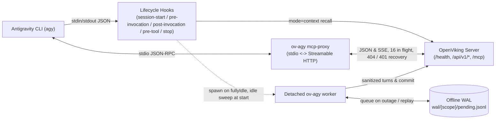

<div align="center">
  
  <h1>agy-openviking</h1>
  <p>Zero-Node-dependency Rust plugin bridging OpenViking's <code>viking://</code> hierarchical context filesystem and long-term memory into Google Antigravity CLI (<code>agy</code>).</p>

  <p>
    <a href="https://github.com/JamCh01/agy-openviking/actions/workflows/ci.yml"></a>
    <a href="https://github.com/JamCh01/agy-openviking/releases"></a>
    <a href="LICENSE"></a>
    <a href="Cargo.toml"></a>
  </p>

  <p>
    <strong>English</strong> | <a href="README.zh-CN.md">简体中文</a> | <a href="README.zh-TW.md">繁體中文</a> | <a href="README.ja.md">日本語</a>
  </p>
</div>

---

## Table of Contents

- [Background](#background)
- [Architecture and Components](#architecture-and-components)
- [Install](#install)
- [Usage and Configuration](#usage-and-configuration)
- [Related Efforts](#related-efforts)
- [Maintainers and Contributing](#maintainers-and-contributing)
- [License](#license)

## Background

[OpenViking](https://github.com/volcengine/OpenViking) organizes agent memories, team documentation, reusable skills, and compiled architectural rules inside a unified `viking://` virtual filesystem with progressive **L0 (abstract) -> L1 (overview) -> L2 (full body)** context tiers.

`agy-openviking` (`ov-agy`) integrates OpenViking into all five customization pillars of Google Antigravity CLI (`agy`)—**MCP Server, Lifecycle Hooks, Subagent, Skills, and Rules**—as a single native Rust binary with **zero Node.js or Python runtime dependencies**:

- **Sub-Millisecond Fast Path & Fail-Open Safety**: Hot-path hooks (`PreToolUse` and `Stop`) execute synchronously in `< 1 ms` without initializing an async runtime. Every hook catches network timeouts and configuration errors, emitting safe fallback JSON with exit code `0` so `agy` never stalls when OpenViking is offline.
- **Turn deduplication.** The first model call uses the current user input and transcript step. Tool iterations (`invocationNum > 0`) and wakeups after a model response skip recall.
- **Git Worktree Peer Normalization**: Resolves linked `.git` worktree pointers (`gitdir:` + `commondir`) back to the shared `.git/config`, normalizing SSH (`git@github.com:Org/Repo.git`) and HTTPS (`https://github.com/Org/Repo.git`) remotes into an identical repository `peer` identifier.
- **Anti-Poisoning Capture & Offline WAL**: Strips injected `<openviking-context>`, `<openviking-session>`, and `<available-skills>` blocks before archiving conversation turns in a detached background worker, buffering unsent payloads in an `fs4`-locked JSONL Write-Ahead Log (`wal/<scope>/pending.jsonl`, up to `10 MiB`) during server outages.

## Architecture and Components

| Component | Entrypoint / File | Responsibility |
| :--- | :--- | :--- |
| **MCP Proxy** | `ov-agy mcp-proxy` (`mcp_config.json`) | Negotiates the workspace with agy using MCP `roots/list` and forwards JSON/SSE requests to `{base_url}/mcp`, up to 16 at once: replies may come back out of order, while `initialize` and notifications keep theirs. An expired session is reinitialized on HTTP 404. After a 401/403 the proxy rereads `ovcli.conf` and `ov.conf` and, if they changed (`ov config switch`, `ov-agy setup`), reconnects once with the new key. A request that outlives the 60 s timeout gets JSON-RPC error `-32004`. |
| **`SessionStart` Hook** | `sh ./scripts/ov-agy hook session-start` | Checks connectivity and injects an `<openviking-session>` status block plus `<openviking-context source="startup">`: the user and project profiles, the memory index and the skill catalog, within `sessionStartMaxBytes`. It also starts the idle sweep. |
| **`PreInvocation` Hook** | `sh ./scripts/ov-agy hook pre-invocation` | Uses `lastUserInput` and the transcript (preferring `transcript_full.jsonl`) to identify the user turn for coding-context recall. After `/compact` it injects the startup block again (`source="compaction"`) and commits the session. |
| **`PostInvocation` Hook** | `sh ./scripts/ov-agy hook post-invocation` | After a turn's final answer, shows a user-only line naming the OpenViking sources the turn used, such as `OpenViking · 3 sources · 2 memories · 1 read` (`usageView`). The model never sees it. |
| **`PreToolUse` Hook** | `sh ./scripts/ov-agy hook pre-tool` | Blocks local file operations whose path starts with `viking://`. A URI quoted in the file body or search pattern is allowed. Every other call gets `ask`, which leaves agy's normal permission flow in charge (agy denies a reply without a decision, and `allow` would bypass your own rules). |
| **`Stop` Hook & Worker** | `sh ./scripts/ov-agy hook stop` -> `ov-agy worker` | On idle Stop, sends finished messages to `agy-{conversationId}` in batches of 100: text verbatim, plus each tool call paired with its result as a `tool` part. It commits once the server reports `commitTokenThreshold` pending tokens, replays the matching offline queue, and records the pass in `last-capture.json`. |
| **Idle Sweep** | `ov-agy sweep` (started by `SessionStart`) | agy has no `SessionEnd`, so a new session commits conversations idle for 30 minutes, replays offline queues, and retires state older than 30 days. |
| **Commands** | `scripts/ov-agy doctor` / `status` / `setup` | `doctor` checks the install, configuration, server and recent activity; `status` shows what the plugin is doing right now; `setup` writes a verified url and key to `ovcli.conf`. |
| **Subagent** | `agents/viking-navigator.md` | Read-only background subagent (`inheritMcp: true`, `commandExecutionPolicy: off`) performing progressive L0 -> L1 -> L2 exploration of `viking://` trees without bloating the main context window. |
| **Skills** | `skills/*/SKILL.md` | `openviking-memory` (choosing a retrieval tool, when to write), `openviking-skills` (stored skills), `/ov-doctor` (diagnostics), `/ov-ingest` (resource and skill ingestion), `/ov-experience` (Experience recall), and `/ov-rule-search` (compiled rules). |
| **Always-On Rule** | `rules/openviking-context.md` | Enforces `viking://` virtual URI boundaries, `viking://~` home-alias addressing, L0 -> L1 -> L2 progressive retrieval, and live workspace provenance priority (`trigger: always_on`). |

With agy 1.5.16, ACP `session/load` restores conversation history without a second `SessionStart`. The next prompt runs semantic recall and capture continues from the saved cursor.



## Install

### Prerequisites

1. **Google Antigravity CLI (`agy`)** installed on macOS or Linux. Windows is untested: the hooks and the MCP server start `sh ./scripts/ov-agy`, so `sh` from Git for Windows must be on `PATH` (choose "Use Git and optional Unix tools from the Command Prompt" when installing it).
2. **OpenViking Server** running locally (`http://127.0.0.1:1933`) or reachable over HTTPS. `ov-agy` checks TLS with rustls against the bundled Mozilla roots and the operating system's trust store (macOS keychain, the Linux CA bundle, the Windows store; `SSL_CERT_FILE` / `SSL_CERT_DIR` replace that store when set). For a private CA outside the store, point `OPENVIKING_CA_CERTS` at its PEM file.

### One-Line Remote Install

```bash
agy plugin install https://github.com/JamCh01/agy-openviking
```

agy's `/plugin` marketplaces list only the catalogs Google curates, so the plugin installs from its GitHub repository (or a local directory, see below).

On the first invocation when no local Cargo build is present, `./scripts/ov-agy` reads the exact plugin `version` from `.antigravity-plugin/plugin.json`, downloads the matching prebuilt binary archive (`aarch64-apple-darwin`, `x86_64-apple-darwin`, `x86_64-unknown-linux-musl`, `aarch64-unknown-linux-musl`, or `x86_64-pc-windows-msvc`) into an isolated temporary directory, verifies its **SHA-256** digest against `checksums.txt`, and atomically places the executable into `${PLUGIN_DATA}/bin/ov-agy-v<version>`. The MCP server launch waits for this download. Hooks never do: agy fails a tool call whose `PreToolUse` hook times out, so until the binary is cached each hook answers at once (`ask` for `PreToolUse`, `{}` otherwise) and starts a single background download.

### Mirror / Restricted Network Acceleration

In Mainland China, corporate intranets, or air-gapped environments, set `OPENVIKING_RELEASE_BASE_URL` to mirror or proxy the GitHub Release asset prefix (hosting `ov-agy-v<version>-<target>.tar.gz` / `.zip` and `checksums.txt`):

```bash
export OPENVIKING_RELEASE_BASE_URL="https://mirror.example.com/JamCh01/agy-openviking/releases/download/v0.2.0"
```

### Build from Source (Local Development)

Requires a stable Rust toolchain (`cargo`, Rust 2021 edition):

```bash
git clone https://github.com/JamCh01/agy-openviking.git
cd agy-openviking
cargo build --release
agy plugin validate --strict .
agy plugin install .
```

When `target/release/ov-agy` (or `target/debug/ov-agy`) exists inside the plugin directory, `./scripts/ov-agy` executes the local binary directly without network downloads.

## Usage and Configuration

### Quick Configuration (`~/.openviking/ovcli.conf`)

The plugin's setup command asks for the url and key, checks them against the server (reachable, key accepted, not the root key), and merges them into `~/.openviking/ovcli.conf`, keeping the previous file as `ovcli.conf.bak-<time>`; both are mode 0600:

```bash
~/.gemini/config/plugins/openviking/scripts/ov-agy setup
# without prompts, keeping the key out of shell history:
printf '%s\n' "$OV_KEY" | ~/.gemini/config/plugins/openviking/scripts/ov-agy setup --url https://ov.example.com --api-key-stdin --yes
```

`--dry-run` shows the merged file with the key masked, and `--no-verify` skips the server check. The OpenViking CLI's `ov config` writes the same file. To write it by hand, create `~/.openviking/ovcli.conf` (`chmod 600`) pointing to your OpenViking server:

```json
{
  "url": "http://127.0.0.1:1933",
  "api_key": "your-user-or-admin-api-key",
  "plugin": {
    "antigravity": {
      "enabled": true
    }
  }
}
```

> [!WARNING]
> **Never use `server.root_api_key` for `/mcp`**: OpenViking restricts `server.root_api_key` (defined in `ov.conf`) to cluster administration and rejects `/mcp` and tenant memory endpoints with `403 Forbidden`. Always provision a **User** (or tenant **Admin**) API key via `ov config`, or connect to a local unauthenticated OpenViking instance on `127.0.0.1:1933`.

### Skills, Subagent, and CLI Diagnostics

- **`/ov-doctor` (Health & Configuration Check)**: Runs `ov-agy doctor`, which reports ok/info/warn/fail findings with a fix for each problem in four sections: the plugin install (manifest, hooks, launcher, MCP entry, enablement in agy), the configuration (sources, url lint, masked key, root-key guard, peer, toggles, proxy variables, TLS roots), the server (`/health` with the identity the key resolves to, `/ready`, `/api/v1/system/status`, a read of `viking://~/memories`, MCP `tools/list`), and recent activity (last injection, recall and capture, offline queues, hook errors in the debug log). The human report exits 1 when a check fails; `--json` always exits 0 and carries `ok`. `ov-agy status` prints a one-screen summary instead. From a terminal:
  ```bash
  ~/.gemini/config/plugins/openviking/scripts/ov-agy doctor
  ~/.gemini/config/plugins/openviking/scripts/ov-agy doctor --json
  ~/.gemini/config/plugins/openviking/scripts/ov-agy status
  ```
- **`openviking-memory` and `openviking-skills`**: model-invoked skills, as in the Codex and Claude Code plugins. The first covers choosing between context search, `find`, list search and `grep`, reading `viking://` URIs, when (not) to write, and where memories are filed; the second covers finding, using, creating, sharing and migrating skills stored in OpenViking.
- **`/ov-ingest` (Knowledge & Skill Ingestion)**: Guided workflow for importing web docs, local specifications, or Git repositories into `viking://resources/...` (`add_resource`) and packaging reusable skills (`add_skill`) while tracking asynchronous L0/L1 indexing tasks.
- **`/ov-experience` (Operational Troubleshooting Recall)**: Searches `viking://~/memories/experiences` with `find` or `search`, then reads the full bodies of at most three matching Experiences with `read`, passing canonical `viking://` URIs verbatim.
- **`/ov-rule-search` (Architectural Compliance Search)**: Queries compiled team constraints via `rule_search` (`applies_when` / `exception` predicates) before modifying unfamiliar modules or public contracts, and reads the Rules an incomplete delivery (`delivery.complete: false`) left out before acting.
- **`viking-navigator` Subagent**: Ask `agy` to delegate broad `viking://resources` or `viking://~/memories` surveys to `viking-navigator`, which triages L0 `.abstract.md` and L1 `.overview.md` summaries before selectively reading L2 source documents.

### Configuration Priority Waterfall

When `OPENVIKING_CREDENTIAL_SOURCE=auto` (default), `ov-agy` resolves settings from highest to lowest priority:

1. **Process Environment Variables** (`OPENVIKING_*`)
2. **Workspace Local Override**: `<repo>/.openviking/config.local.json`
3. **Workspace Shared Config**: `<repo>/.openviking/config.json`
4. **OpenViking CLI Config**: `~/.openviking/ovcli.conf` (or `OPENVIKING_CLI_CONFIG_FILE`, including `plugin.antigravity.*` and `plugin.*`)
5. **OpenViking Server Config**: `~/.openviking/ov.conf` (or `OPENVIKING_CONFIG_FILE`, including `server.*` and `antigravity.*`)
6. **Built-in Defaults**: `http://127.0.0.1:1933` (if neither config files nor `OPENVIKING_MEMORY_ENABLED` exist, the plugin remains silently disabled with zero overhead).

A repository's `.openviking/config.json` and `.openviking/config.local.json` may set only `peer.{id,source}`, `recall.{enabled,peer_scope,dedup_turns,max_items,score_threshold}`, `capture.{enabled,commit_token_threshold}`, `bypass.session_patterns` and `usage.{view,output}`, because anyone can commit them. A personal registry entry in `~/.openviking/workspaces/` with the same keys outranks both for the repository it names. Filters, debug logging, timeouts and other behavior come from your personal configuration or environment, and so do the server URL, API key, account and user; `ov-agy doctor` lists every ignored key. Offline queues are scoped to those connection details and the peer. The legacy `wal/pending.jsonl` is retained for manual recovery.

### Environment Variables Reference

| Variable | Default | Description |
| :--- | :--- | :--- |
| `OPENVIKING_MEMORY_ENABLED` | Auto (by config presence) | Master switch (`1`/`true`/`yes`/`on` or `0`/`false`/`no`/`off`). |
| `OPENVIKING_CREDENTIAL_SOURCE` | `auto` | Credential source policy: `auto`, `cli` (config files only), or `env` (environment only). |
| `OPENVIKING_URL` / `OPENVIKING_BASE_URL` | `http://127.0.0.1:1933` | OpenViking HTTP server base URL. |
| `OPENVIKING_MCP_URL` | `{base_url}/mcp` | Override endpoint URL for Streamable HTTP MCP. |
| `OPENVIKING_API_KEY` / `OPENVIKING_BEARER_TOKEN` | *(empty)* | User or tenant Admin API key, sent as `Authorization: Bearer`. |
| `OPENVIKING_ACCOUNT` | *(empty)* | Account for trusted mode, sent as `X-OpenViking-Account`. |
| `OPENVIKING_USER` | *(empty)* | User for trusted mode, sent as `X-OpenViking-User`. |
| `OPENVIKING_AUTH_MODE` | `api_key`, or `trusted` when an account or user is set | `trusted` sends the account and user headers; with `api_key` the key alone carries the identity. |
| `OPENVIKING_EXTRA_HEADERS` | *(empty)* | JSON object of extra request headers for a gateway in front of the server (for example Cloudflare Access). `Authorization`, `X-API-Key`, `Accept`, `Content-Type` and the MCP headers cannot be overridden. |
| `OPENVIKING_CA_CERTS` | *(empty)* | PEM bundle of extra trusted CA certificates, added to the bundled Mozilla roots and the system store. Also `caCerts` in the `plugin.antigravity` block of `ovcli.conf`; falls back to `NODE_EXTRA_CA_CERTS`, which the Node-based OpenViking plugins read. Repository files cannot set it. |
| `OPENVIKING_PEER_ID` | Auto (Git remote / dir) | Explicit `X-OpenViking-Actor-Peer` repository peer identifier override. |
| `OPENVIKING_PEER_SOURCE` | `git` | How the peer is derived when none is set: `git` (the `origin` remote, else the repository root), `cwd`, `none`, or a template with `{git_remote}`, `{git_root}`, `{cwd}`, `{dir}` and `{harness}`. |
| `OPENVIKING_HOME` | `~/.openviking` | Base directory for OpenViking configuration and logs. |
| `OPENVIKING_CLI_CONFIG_FILE` | `~/.openviking/ovcli.conf` | Path override for the OpenViking CLI JSON config file. |
| `OPENVIKING_CONFIG_FILE` | `~/.openviking/ov.conf` | Path override for the OpenViking server JSON config file. |
| `OPENVIKING_PLUGIN_DATA` / `OPENVIKING_STATE_DIR` | `~/.openviking/agy-plugin` | Persistent directory for turn state, locks, `wal/<scope>/pending.jsonl`, and cached binaries. |
| `OPENVIKING_TIMEOUT_MS` | `15000` | HTTP request timeout in milliseconds (`500`–`300000`). |
| `OPENVIKING_AUTO_RECALL` | `true` | Enables automatic turn-level context recall in `PreInvocation`. |
| `OPENVIKING_AUTO_CAPTURE` | `true` | Enables detached conversation turn capture on `Stop` and the idle sweep on `SessionStart`. |
| `OPENVIKING_RECALL_LIMIT` | Server preset | Distributes explicit values (1–50) across six coding sources with at least one slot each. Legacy find defaults to 6. |
| `OPENVIKING_RECALL_MAX_TOKENS` | Server default | Token budget for context recall (64–32000). |
| `OPENVIKING_RECALL_REWRITE` | Off | Request server rewriting with `server` or `auto`. Rewriting needs a recall budget of tens of seconds. |
| `OPENVIKING_RECALL_TIMEOUT_MS` | `3800` | Recall request budget in `PreInvocation` (`1000`–`25000`). Every new prompt waits for it, so raise it only for a slow server. |
| `OPENVIKING_RECALL_QUERY_EXPANSION` | `off` below 10 s | `auto` or `off`. The server's query expansion cannot finish inside a short budget, so recall sends `off` unless you choose a mode or raise the budget to 10 s or more. |
| `OPENVIKING_NO_AUTO_INJECT` | `false` | Skip the startup block (profiles, memory index, skills). Per-prompt recall stays on. |
| `OPENVIKING_PROFILE_TOKEN_BUDGET` | `10000` | Tokens for the startup profiles and memory index (`500`–`50000`). |
| `OPENVIKING_SKILL_CATALOG` | `true` | Include the `<available-skills>` catalog in the startup block. |
| `OPENVIKING_SKILL_CATALOG_TOKEN_BUDGET` | `1200` | Tokens for the skill catalog; names only when descriptions do not fit. |
| `OPENVIKING_SESSION_START_MAX_BYTES` | `9500` | UTF-8 cap on the startup block. The profile, index and catalog budgets shrink to fit under it (about 4 bytes per token), so a large memory index is trimmed with "+N more" lines; only if an estimate still overshoots is the index dropped, then the catalog. |
| `OPENVIKING_RECALL_DEDUP_TURNS` | `5` | Server-side cross-turn deduplication window (`0`–`20`). |
| `OPENVIKING_SCORE_THRESHOLD` | `0.35` | Minimum relevance score threshold for recalled entries (`0.0`–`1.0`). |
| `OPENVIKING_MIN_QUERY_LENGTH` | `3` | Minimum user prompt character count required to trigger recall (`1`–`64`). |
| `OPENVIKING_RECALL_PEER_SCOPE` | `all` | Recall peer filter scope: `all` or `actor`. |
| `OPENVIKING_RECALL_EXCLUDE_URIS` | *(empty)* | Comma-separated or JSON array of `viking://` URI prefixes to exclude from recall. |
| `OPENVIKING_RECALL_QUERY_FILTERS` | *(empty)* | `sed`-style (`s/pat/rep/g`, `d/pat/`, `k/pat/`) or regex drop rules applied before recall. |
| `OPENVIKING_CAPTURE_FILTERS` | *(empty)* | `sed`-style or regex redaction/drop rules (supports `user:` / `assistant:` prefixes) before capture. |
| `OPENVIKING_CAPTURE_TOOL_CALLS` | `true` | Captures tool calls and their results (file reads, commands, MCP calls) as `tool` parts. Set `false` to send only the conversation text. |
| `OPENVIKING_CAPTURE_TOOL_MAX_CHARS` | `1000000` | Guard for pathological tool payloads (`200`–`1000000`); the server externalizes large output itself. Longer values keep their head and tail around an omission marker. |
| `OPENVIKING_COMMIT_TOKEN_THRESHOLD` | `20000` | Commit when the session has this many pending tokens (`1000`–`1000000`), as the Codex and Claude Code plugins do. A repository may set `capture.commit_token_threshold`. |
| `OPENVIKING_COMMIT_EVERY_TURNS` | *(unset)* | Optional extra trigger: also commit after this many uncommitted messages (`1`–`1000`). |
| `OPENVIKING_AGY_IDLE_TTL_MS` | `1800000` | agy has no `SessionEnd`, so the next `SessionStart` commits conversations idle this long (at most one sweep per 10 minutes). |
| `OPENVIKING_IDLE_SWEEP` | `true` | Set `false` to stop `SessionStart` from starting the idle sweep. |
| `OPENVIKING_AUTO_COMMIT_ON_COMPACT` | `true` | Commit the session when agy compacts the conversation. |
| `OPENVIKING_RESUME_ARCHIVE_INJECT` | `false` | Add the latest session archive overview to the context injected after `/compact`. |
| `OPENVIKING_RESUME_ARCHIVE_TOKEN_BUDGET` / `OPENVIKING_RESUME_ARCHIVE_MAX_CHARS` | `32000` / `6000` | Size limits for that archive overview. |
| `OPENVIKING_USAGE_VIEW` | `summary` | The per-answer source line: `summary`, `expanded` (one line per source) or `off`. |
| `OPENVIKING_USAGE_OUTPUT` | `notice` | `notice` shows the line to the user only; `footer` asks the model to end its answer with the sources it used. |
| `OPENVIKING_BYPASS_SESSION` | `false` | Every hook skips the server. |
| `OPENVIKING_BYPASS_SESSION_PATTERNS` | *(empty)* | Comma-separated globs (`**` crosses `/`) matched against the conversation id, `agy-<id>` and the workspace path; a match skips recall and capture. |
| `OPENVIKING_PENDING_TTL_DAYS` / `OPENVIKING_PENDING_MAX_RETRIES` | `7` / `50` | Offline-queue entries older than this, or retried this often, are dropped. |
| `OPENVIKING_DEBUG` | `false` | Appends structured diagnostic events to `OPENVIKING_DEBUG_LOG` (never `stdout`). |
| `OPENVIKING_DEBUG_LOG` | `~/.openviking/logs/agy.jsonl` | File path for JSONL diagnostic logs when `OPENVIKING_DEBUG=true`. |
| `OPENVIKING_RELEASE_BASE_URL` | GitHub Releases URL | Custom base URL prefix used by `scripts/fetch-binary.sh` for prebuilt binary downloads. |

## Related Efforts

- [volcengine/OpenViking](https://github.com/volcengine/OpenViking) — The open-source context database for AI Agents providing the `viking://` L0/L1/L2 virtual filesystem, memory extraction, and Streamable HTTP MCP server.
- [Google Antigravity Documentation](https://antigravity.google/docs) — Official documentation for Antigravity CLI (`agy`) plugins, lifecycle hooks, MCP servers, subagents, skills, and rules.
- [Wire Contract Specification](docs/WIRE_CONTRACT.md) — Complete HTTP REST, Streamable HTTP MCP, and Antigravity hook stdin/stdout JSON contract implemented by `ov-agy`.

## Maintainers and Contributing

Maintained by [@JamCh01](https://github.com/JamCh01). Issues and Pull Requests are welcome at [JamCh01/agy-openviking](https://github.com/JamCh01/agy-openviking/issues).

Before submitting a Pull Request, run the full verification suite locally:

```bash
cargo fmt --check
cargo clippy --all-targets -- -D warnings
cargo test
agy plugin validate --strict .
```

Rust code follows the [Google Rust Style Guide](https://google.github.io/styleguide/rustguide.html), and commit messages follow the [Angular Commit Message Guidelines](https://github.com/angular/angular/blob/main/contributing-docs/commit-message-guidelines.md).

## License

Licensed under the [Apache License, Version 2.0](LICENSE).

`agy-openviking` (`ov-agy`) is an independent, clean-room external client that communicates with OpenViking strictly over its documented public HTTP REST (`/health`, `/api/v1/*`) and Streamable HTTP MCP (`/mcp`) protocols without linking or redistributing internal server source code.
