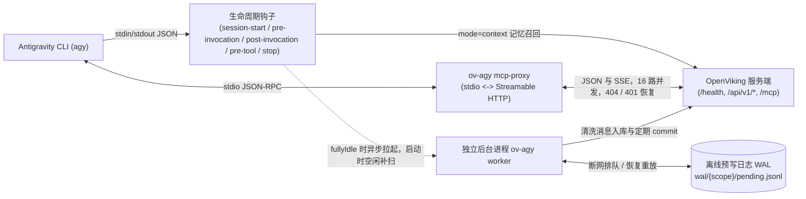

<div align="center">
  
  <h1>agy-openviking</h1>
  <p>零 Node.js 运行时依赖的 Rust 原生插件，将 OpenViking 的 <code>viking://</code> 分层上下文虚拟文件系统与长期记忆桥接至 Google Antigravity CLI（<code>agy</code>）。</p>

  <p>
    <a href="https://github.com/JamCh01/agy-openviking/actions/workflows/ci.yml"></a>
    <a href="https://github.com/JamCh01/agy-openviking/releases"></a>
    <a href="LICENSE"></a>
    <a href="Cargo.toml"></a>
  </p>

  <p>
    <a href="README.md">English</a> | <strong>简体中文</strong> | <a href="README.zh-TW.md">繁體中文</a> | <a href="README.ja.md">日本語</a>
  </p>
</div>

---

## 目录

- [背景](#背景)
- [核心架构与组件](#核心架构与组件)
- [安装](#安装)
- [使用说明与配置](#使用说明与配置)
- [相关项目](#相关项目)
- [维护者与贡献指南](#维护者与贡献指南)
- [许可证](#许可证)

## 背景

[OpenViking](https://github.com/volcengine/OpenViking) 通过统一的 `viking://` 虚拟文件系统管理智能体长期记忆、团队工程文档、可复用技能与编译态架构规则，并提供 **L0（摘要）-> L1（概览）-> L2（全文）** 渐进式上下文分层能力。

`agy-openviking`（`ov-agy`）以**零 Node.js / Python 运行时依赖**的 Rust 单一编译二进制，将 OpenViking 完整桥接至 Google Antigravity CLI（`agy`）的五大扩展支柱（**MCP 服务 + 生命周期钩子 + 异步子 Agent + 技能包 + 常驻规则**）：

- **亚毫秒级同步热路径与降级放行（Fail-Open）**：高频生命周期钩子（`PreToolUse` 与 `Stop`）走零异步运行时开销的同步热路径（`< 1 ms`）；所有钩子统一捕获网络超时与配置异常并以退出码 `0` 返回合法兜底 JSON，确保 OpenViking 离线时绝不阻塞 `agy` 主流程。
- **按用户轮次去重。** 首次模型调用根据当前提问和对话步骤召回。工具循环（`invocationNum > 0`）及模型回复后的后台唤醒跳过召回。
- **Git Worktree 仓库级 Peer 归一化**：自动解析链式 Git 工作树（`.git` 文件中的 `gitdir:` 与 `commondir`）回溯共享 `.git/config`，将 SSH（`git@github.com:Org/Repo.git`）与 HTTPS（`https://github.com/Org/Repo.git`）远端地址归一化为同一仓库级 `peer` 标识。
- **防记忆自污染采集与离线预写日志（WAL）**：后台独立进程 `ov-agy worker` 在归档对话前自动剥离 `<openviking-context>`、`<openviking-session>` 与 `<available-skills>` 注入块；服务端不可达时通过 `fs4` 文件锁将待写消息持久化至 `wal/<scope>/pending.jsonl`（上限 `10 MiB`），待服务恢复后自动重放。

## 核心架构与组件

| 组件 | 入口 / 文件路径 | 职责边界 |
| :--- | :--- | :--- |
| **MCP 代理（`mcp-proxy`）** | `ov-agy mcp-proxy`（`mcp_config.json`） | 通过 MCP `roots/list` 获取 agy 工作区，向 `{base_url}/mcp` 转发 JSON/SSE 请求，最多同时 16 个：响应可能乱序返回，而 `initialize` 和通知保持原有顺序。会话过期返回 HTTP 404 时重新握手。收到 401/403 后，代理会重新读取 `ovcli.conf` 和 `ov.conf`；若它们已变化（`ov config switch`、`ov-agy setup`），则用新密钥重连一次。请求超出 60 秒超时限制时，会收到 JSON-RPC 错误 `-32004`。 |
| **`SessionStart` 生命周期钩子** | `sh ./scripts/ov-agy hook session-start` | 检查连接，注入 `<openviking-session>` 状态块和 `<openviking-context source="startup">`：用户和项目画像、记忆索引与技能清单，大小不超过 `sessionStartMaxBytes`。此外还会启动空闲补扫。 |
| **`PreInvocation` 生命周期钩子** | `sh ./scripts/ov-agy hook pre-invocation` | 通过 `lastUserInput` 和对话日志识别提问轮次，优先读取 `transcript_full.jsonl`，按编程场景召回。`/compact` 之后重新注入启动块（`source="compaction"`）并提交会话。 |
| **`PostInvocation` 生命周期钩子** | `sh ./scripts/ov-agy hook post-invocation` | 在一轮的最终回答之后，显示一行仅用户可见的提示，列出该轮用到的 OpenViking 来源，例如 `OpenViking · 3 sources · 2 memories · 1 read`（`usageView`）。模型始终看不到这一行。 |
| **`PreToolUse` 生命周期钩子** | `sh ./scripts/ov-agy hook pre-tool` | 拦截路径以 `viking://` 开头的本地文件操作。文件正文和搜索关键词可以引用该 URI。其他调用一律返回 `ask`，交给 agy 原有的权限流程处理（agy 会拒绝没有 decision 的回复，而 `allow` 会绕过你自己的权限规则）。 |
| **`Stop` 钩子与后台 `worker`** | `sh ./scripts/ov-agy hook stop` -> `ov-agy worker` | 空闲时将已完成的消息按每批 100 条写入 `agy-{conversationId}`：正文原样发送，每个工具调用和它的结果配成一个 `tool` part。服务端待提交 token 达到 `commitTokenThreshold` 时才提交，同时重放当前身份的离线队列，并把本次采集记录到 `last-capture.json`。 |
| **空闲补扫（Idle Sweep）** | `ov-agy sweep`（由 `SessionStart` 启动） | agy 没有 `SessionEnd`，因此新会话启动时会提交闲置 30 分钟的对话、重放离线队列，并清理超过 30 天的状态。 |
| **命令（Commands）** | `scripts/ov-agy doctor` / `status` / `setup` | `doctor` 检查安装、配置、服务端和近期活动；`status` 显示插件当前在做什么；`setup` 把验证通过的服务地址和密钥写入 `ovcli.conf`。 |
| **异步子 Agent** | `agents/viking-navigator.md` | 只读后台检索子 Agent（`inheritMcp: true`，`commandExecutionPolicy: off`），按 L0 -> L1 -> L2 分层探索 `viking://` 知识树并返回带精确 URI 引用的精炼结论，保持主对话上下文精简。 |
| **技能（Skills）** | `skills/*/SKILL.md` | `openviking-memory`（选择检索工具、何时写入）、`openviking-skills`（已存储的技能）、`/ov-doctor`（诊断）、`/ov-ingest`（资源与技能入库）、`/ov-experience`（经验召回）、`/ov-rule-search`（编译态规则）。 |
| **常驻规则（Rules）** | `rules/openviking-context.md` | 顶部显式声明 `trigger: always_on`，约束模型遵守 `viking://` 虚拟路径边界、`viking://~` 主目录别名寻址、L0 -> L1 -> L2 渐进检索及本地工作区事实优先原则。 |

在 agy 1.5.16 中，ACP 的 `session/load` 会恢复历史，但不会再次触发 `SessionStart`。下一次提问仍会执行语义召回，采集从上次保存的位置继续。



## 安装

### 前置依赖

1. 已在 macOS 或 Linux 上安装 **Google Antigravity CLI（`agy`）**。Windows 未经测试：钩子和 MCP 服务通过 `sh ./scripts/ov-agy` 启动，因此 Git for Windows 提供的 `sh` 必须在 `PATH` 中（安装 Git for Windows 时请选择 “Use Git and optional Unix tools from the Command Prompt”）。
2. 已部署可访问的 **OpenViking 服务端**（本地默认 `http://127.0.0.1:1933` 或远端 HTTPS 实例）。`ov-agy` 用 rustls 校验 TLS，信任内置的 Mozilla 根证书和操作系统的证书库（macOS 钥匙串、Linux CA 证书包、Windows 证书存储；设置了 `SSL_CERT_FILE` / `SSL_CERT_DIR` 时改用它们指定的证书）。私有 CA 不在系统证书库里时，把 `OPENVIKING_CA_CERTS` 指向它的 PEM 文件。

### 一行命令远程安装

```bash
agy plugin install https://github.com/JamCh01/agy-openviking
```

agy 的 `/plugin` 市场只列出 Google 精选的目录，因此本插件从其 GitHub 仓库安装（或使用本地目录，见下文）。

首次冷启动且本地不存在源码编译产物时，`./scripts/ov-agy` 会自动从 `.antigravity-plugin/plugin.json` 读取 `version` 版本号，在独立的 `mktemp` 临时目录下载对应平台的预编译二进制包（覆盖 `aarch64-apple-darwin`、`x86_64-apple-darwin`、`x86_64-unknown-linux-musl`、`aarch64-unknown-linux-musl`、`x86_64-pc-windows-msvc`），完成 `checksums.txt` 的 **SHA-256** 完整性校验后通过同目录原子重命名（`mv -f`）落盘至 `${PLUGIN_DATA}/bin/ov-agy-v<version>`，避免 `mcp-proxy` 与 `SessionStart` 并发冷启动竞争。MCP 服务启动时会等待下载完成，钩子不会：`PreToolUse` 钩子超时会让 agy 直接判定工具调用失败，所以二进制缓存好之前，钩子一律立即返回（`PreToolUse` 返回 `ask`，其余返回 `{}`），并只在后台发起一次下载。

### 中国大陆或受限网络加速下载

若处于中国大陆网络环境、企业内网或受限网络，可通过环境变量 `OPENVIKING_RELEASE_BASE_URL` 指定镜像站或内网制品库前缀（目录内放置对应版本的压缩包与 `checksums.txt`）：

```bash
export OPENVIKING_RELEASE_BASE_URL="https://mirror.example.com/JamCh01/agy-openviking/releases/download/v0.2.0"
```

### 从源码本地构建开发

需要安装稳定版 Rust 工具链（`cargo`，Rust 2021 Edition）：

```bash
git clone https://github.com/JamCh01/agy-openviking.git
cd agy-openviking
cargo build --release
agy plugin validate --strict .
agy plugin install .
```

当插件目录下存在 `target/release/ov-agy`（或 `target/debug/ov-agy`）时，`./scripts/ov-agy` 会优先直接执行本地编译产物，不触发远端下载。

## 使用说明与配置

### 快速配置（`~/.openviking/ovcli.conf`）

插件的 setup 命令会询问服务地址和密钥，向服务端验证（可连通、密钥被接受、不是 Root Key），并合并写入 `~/.openviking/ovcli.conf`，原文件保留为 `ovcli.conf.bak-<time>`；两个文件的权限均为 0600：

```bash
~/.gemini/config/plugins/openviking/scripts/ov-agy setup
# without prompts, keeping the key out of shell history:
printf '%s\n' "$OV_KEY" | ~/.gemini/config/plugins/openviking/scripts/ov-agy setup --url https://ov.example.com --api-key-stdin --yes
```

`--dry-run` 显示合并后的文件（密钥已脱敏），`--no-verify` 跳过服务端检查。OpenViking CLI 的 `ov config` 写入的是同一个文件。如需手工编写，请创建 `~/.openviking/ovcli.conf`（建议权限 `chmod 600`）连接本地或远端 OpenViking 服务端：

```json
{
  "url": "http://127.0.0.1:1933",
  "api_key": "your-user-or-admin-api-key",
  "plugin": {
    "antigravity": {
      "enabled": true
    }
  }
}
```

> [!WARNING]
> **切勿在 `/mcp` 使用服务端 `server.root_api_key`**：OpenViking 仅允许 `ov.conf` 中的 `server.root_api_key` 调用集群管理接口，访问 `/mcp` 及租户记忆接口会直接返回 `403 Forbidden`。请通过 `ov config` 签发并配置 **User Key**（或租户 **Admin Key**），或在本地 `127.0.0.1:1933` 使用免鉴权开发模式。

### 技能、子 Agent 与命令行自检用法

- **`/ov-doctor`（连通性与配置自检）**：运行 `ov-agy doctor`，分四部分报告 ok/info/warn/fail 级别的检查结果，并为每个问题给出修复方法：插件安装（manifest、钩子、启动器、MCP 条目、agy 中的启用状态）、配置（来源、url 检查、脱敏 API Key、Root Key 误配预警、peer、开关、代理变量、TLS 根证书）、服务端（`/health` 及密钥对应的身份、`/ready`、`/api/v1/system/status`、试读 `viking://~/memories`、MCP `tools/list`）以及近期活动（最近一次注入、召回和采集、离线队列、调试日志中的钩子错误）。文本报告在有检查失败时退出码为 1；`--json` 始终以退出码 0 结束，并带有 `ok` 字段。`ov-agy status` 则输出一屏摘要。在终端中运行：
  ```bash
  ~/.gemini/config/plugins/openviking/scripts/ov-agy doctor
  ~/.gemini/config/plugins/openviking/scripts/ov-agy doctor --json
  ~/.gemini/config/plugins/openviking/scripts/ov-agy status
  ```
- **`openviking-memory` 与 `openviking-skills`**：由模型自行调用的技能，与 Codex 和 Claude Code 插件中的做法相同。前者涵盖如何在上下文搜索、`find`、列表搜索和 `grep` 之间选择、如何读取 `viking://` URI、何时写入与何时不写入，以及记忆存放在哪里；后者涵盖查找、使用、创建、共享和迁移存储在 OpenViking 中的技能。
- **`/ov-ingest`（知识与技能入库）**：标准化导入外部网页文档、本地规范说明或 Git 仓库至 `viking://resources/...`（调用 `add_resource`），或导入智能体技能包（调用 `add_skill`），并跟踪异步 L0/L1 索引任务完成状态。
- **`/ov-experience`（排障经验检索）**：用 `find` 或 `search` 检索 `viking://~/memories/experiences`，再用 `read` 读取最多三条匹配经验的完整正文，原样传递标准 `viking://` URI。
- **`/ov-rule-search`（编译态架构规范检索）**：修改陌生模块、公共接口或安全边界前，调用 `rule_search` 检查团队编译态架构规则（核验 `applies_when` 与 `exception` 条件），并在行动前读取因返回不完整（`delivery.complete: false`）而被遗漏的规则。
- **委派 `viking-navigator` 子 Agent**：面对跨目录大型文档检索时，可指示 `agy` 委派 `viking-navigator` 子 Agent 按 L0 `.abstract.md` -> L1 `.overview.md` -> L2 原文的顺序异步探索并汇总证据。

### 配置文件与凭证优先级链

当 `OPENVIKING_CREDENTIAL_SOURCE=auto`（默认值）时，`ov-agy` 按以下从高到低的优先级合并配置：

1. **进程环境变量**（`OPENVIKING_*`）
2. **工作区本地私有覆盖**：`<repo>/.openviking/config.local.json`
3. **工作区团队共享配置**：`<repo>/.openviking/config.json`
4. **OpenViking CLI 配置文件**：`~/.openviking/ovcli.conf`（或 `OPENVIKING_CLI_CONFIG_FILE`，支持 `plugin.antigravity.*` 与 `plugin.*`）
5. **OpenViking 服务端配置文件**：`~/.openviking/ov.conf`（或 `OPENVIKING_CONFIG_FILE`，支持 `server.*` 与 `antigravity.*`）
6. **内置默认值**：`http://127.0.0.1:1933`（若未检测到任何配置文件且未显式设置 `OPENVIKING_MEMORY_ENABLED`，插件自动保持静默关闭，零额外开销）。

仓库里的 `.openviking/config.json` 和 `.openviking/config.local.json` 任何人都能提交，所以只能设置 `peer.{id,source}`、`recall.{enabled,peer_scope,dedup_turns,max_items,score_threshold}`、`capture.{enabled,commit_token_threshold}`、`bypass.session_patterns` 和 `usage.{view,output}`。`~/.openviking/workspaces/` 中的个人登记条目可设置相同的键，对其所指的仓库，优先级高于这两个文件。过滤规则、调试日志、超时等其他行为设置只从个人配置或环境变量读取，服务地址、API 密钥、账号和用户同样如此；被忽略的键会在 `ov-agy doctor` 中逐一列出。离线队列按这些连接信息及 peer 隔离，旧版 `wal/pending.jsonl` 保留供手工恢复。

### 环境变量完整列表

| 环境变量 | 默认值 | 说明 |
| :--- | :--- | :--- |
| `OPENVIKING_MEMORY_ENABLED` | 自动（按配置文件存在性） | 插件总开关（`1`/`true`/`yes`/`on` 开启，`0`/`false`/`no`/`off` 关闭）。 |
| `OPENVIKING_CREDENTIAL_SOURCE` | `auto` | 凭证来源策略：`auto`、`cli`（仅读取配置文件）或 `env`（仅读取环境变量）。 |
| `OPENVIKING_URL` / `OPENVIKING_BASE_URL` | `http://127.0.0.1:1933` | OpenViking HTTP 服务端基础地址。 |
| `OPENVIKING_MCP_URL` | `{base_url}/mcp` | 自定义 Streamable HTTP MCP 端点地址。 |
| `OPENVIKING_API_KEY` / `OPENVIKING_BEARER_TOKEN` | *(空)* | User 或租户 Admin 级别 API Key，以 `Authorization: Bearer` 发送。 |
| `OPENVIKING_ACCOUNT` | *(空)* | trusted 模式使用的账号，以 `X-OpenViking-Account` 发送。 |
| `OPENVIKING_USER` | *(空)* | trusted 模式使用的用户，以 `X-OpenViking-User` 发送。 |
| `OPENVIKING_AUTH_MODE` | `api_key`；设置了账号或用户时为 `trusted` | `trusted` 发送账号和用户请求头；`api_key` 模式下身份仅由密钥决定。 |
| `OPENVIKING_EXTRA_HEADERS` | *(空)* | 额外请求头的 JSON 对象，供服务端前方的网关使用（例如 Cloudflare Access）。`Authorization`、`X-API-Key`、`Accept`、`Content-Type` 和 MCP 请求头不能被覆盖。 |
| `OPENVIKING_CA_CERTS` | *(空)* | 额外信任的 CA 证书（PEM 证书包），叠加在内置 Mozilla 根证书和系统证书库之上。也可在 `ovcli.conf` 的 `plugin.antigravity` 块中设置 `caCerts`；未设置时回退到 Node 版 OpenViking 插件读取的 `NODE_EXTRA_CA_CERTS`。仓库内的配置文件不能设置它。 |
| `OPENVIKING_PEER_ID` | 自动（Git 远端或目录名） | 显式覆盖 `X-OpenViking-Actor-Peer` 仓库级 Peer 标识。 |
| `OPENVIKING_PEER_SOURCE` | `git` | 未设置 peer 标识时的推导方式：`git`（`origin` 远端，否则取仓库根目录）、`cwd`、`none`，或包含 `{git_remote}`、`{git_root}`、`{cwd}`、`{dir}` 和 `{harness}` 的模板。 |
| `OPENVIKING_HOME` | `~/.openviking` | OpenViking 基础配置与日志根目录。 |
| `OPENVIKING_CLI_CONFIG_FILE` | `~/.openviking/ovcli.conf` | 自定义 `ovcli.conf` 文件路径。 |
| `OPENVIKING_CONFIG_FILE` | `~/.openviking/ov.conf` | 自定义 `ov.conf` 文件路径。 |
| `OPENVIKING_PLUGIN_DATA` / `OPENVIKING_STATE_DIR` | `~/.openviking/agy-plugin` | 会话状态、文件锁、离线 `wal/<scope>/pending.jsonl` 与预编译二进制缓存目录。 |
| `OPENVIKING_TIMEOUT_MS` | `15000` | HTTP 请求超时时间，单位毫秒（范围 `500`–`300000`）。 |
| `OPENVIKING_AUTO_RECALL` | `true` | 是否在 `PreInvocation` 阶段启用自动上下文记忆召回。 |
| `OPENVIKING_AUTO_CAPTURE` | `true` | 是否在 `Stop` 阶段启用后台对话采集，以及 `SessionStart` 时的空闲补扫。 |
| `OPENVIKING_RECALL_LIMIT` | 服务端预设 | 显式设置后按权重分配给六类来源，每类至少一项（取值 1–50）。旧版 find 默认取 6 项。 |
| `OPENVIKING_RECALL_MAX_TOKENS` | 服务端默认 | 上下文召回的 token 预算（64–32000）。 |
| `OPENVIKING_RECALL_REWRITE` | 关闭 | 设为 `server` 或 `auto` 启用服务端改写。改写需要几十秒的召回预算。 |
| `OPENVIKING_RECALL_TIMEOUT_MS` | `3800` | `PreInvocation` 中召回请求的时间预算（`1000`–`25000`）。每个新提示都要等它，只在服务端较慢时调大。 |
| `OPENVIKING_RECALL_QUERY_EXPANSION` | 预算低于 10 秒时为 `off` | `auto` 或 `off`。短预算内服务端的查询扩展跑不完，所以除非你指定模式或把预算调到 10 秒以上，召回都会发送 `off`。 |
| `OPENVIKING_NO_AUTO_INJECT` | `false` | 跳过启动块（画像、记忆索引、技能清单）。逐轮召回仍保持开启。 |
| `OPENVIKING_PROFILE_TOKEN_BUDGET` | `10000` | 启动画像和记忆索引的 token 预算（`500`–`50000`）。 |
| `OPENVIKING_SKILL_CATALOG` | `true` | 在启动块中包含 `<available-skills>` 技能清单。 |
| `OPENVIKING_SKILL_CATALOG_TOKEN_BUDGET` | `1200` | 技能清单的 token 预算；描述放不下时只保留名称。 |
| `OPENVIKING_SESSION_START_MAX_BYTES` | `9500` | 启动块的 UTF-8 字节上限。画像、记忆索引和技能清单的 token 预算会按约 4 字节/token 缩小到上限以内，记忆很多时索引会截短并附“+N more”；估算仍超出时才先舍弃记忆索引，再舍弃技能清单。 |
| `OPENVIKING_RECALL_DEDUP_TURNS` | `5` | 服务端跨轮次去重窗口大小（范围 `0`–`20`）。 |
| `OPENVIKING_SCORE_THRESHOLD` | `0.35` | 召回结果最低相关性分数阈值（范围 `0.0`–`1.0`）。 |
| `OPENVIKING_MIN_QUERY_LENGTH` | `3` | 触发记忆召回的最短用户提问字符数（范围 `1`–`64`）。 |
| `OPENVIKING_RECALL_PEER_SCOPE` | `all` | 记忆召回 Peer 过滤范围：`all` 或 `actor`。 |
| `OPENVIKING_RECALL_EXCLUDE_URIS` | *(空)* | 召回时排除的 `viking://` URI 前缀列表（逗号分隔或 JSON 数组）。 |
| `OPENVIKING_RECALL_QUERY_FILTERS` | *(空)* | 召回前应用于查询文本的 `sed` 风格（`s/pat/rep/g`、`d/pat/`、`k/pat/`）或正则过滤规则。 |
| `OPENVIKING_CAPTURE_FILTERS` | *(空)* | 采集前脱敏或丢弃规则（支持 `user:` / `assistant:` 角色前缀）。 |
| `OPENVIKING_CAPTURE_TOOL_CALLS` | `true` | 将工具调用及其结果（读文件、命令、MCP 调用）作为 `tool` part 采集。设为 `false` 时只发送对话正文。 |
| `OPENVIKING_CAPTURE_TOOL_MAX_CHARS` | `1000000` | 防止异常超大工具载荷的上限（`200`–`1000000`），大输出由服务端自行外置。超长内容保留首尾，中间用省略标记代替。 |
| `OPENVIKING_COMMIT_TOKEN_THRESHOLD` | `20000` | 会话待提交 token 达到该值时提交（`1000`–`1000000`），与 Codex、Claude Code 插件一致。仓库可设置 `capture.commit_token_threshold`。 |
| `OPENVIKING_COMMIT_EVERY_TURNS` | *（未设置）* | 可选的附加触发条件：未提交消息达到该数量时也提交（`1`–`1000`）。 |
| `OPENVIKING_AGY_IDLE_TTL_MS` | `1800000` | agy 没有 `SessionEnd`，因此下一次 `SessionStart` 会提交闲置超过该时长的对话（每 10 分钟最多补扫一次）。 |
| `OPENVIKING_IDLE_SWEEP` | `true` | 设为 `false` 可禁止 `SessionStart` 启动空闲补扫。 |
| `OPENVIKING_AUTO_COMMIT_ON_COMPACT` | `true` | agy 压缩对话时提交会话。 |
| `OPENVIKING_RESUME_ARCHIVE_INJECT` | `false` | 把最近一次会话归档的概览加入 `/compact` 之后注入的上下文。 |
| `OPENVIKING_RESUME_ARCHIVE_TOKEN_BUDGET` / `OPENVIKING_RESUME_ARCHIVE_MAX_CHARS` | `32000` / `6000` | 该归档概览的大小限制。 |
| `OPENVIKING_USAGE_VIEW` | `summary` | 每次回答的来源行：`summary`、`expanded`（每个来源一行）或 `off`。 |
| `OPENVIKING_USAGE_OUTPUT` | `notice` | `notice` 只向用户显示该行；`footer` 则要求模型在回答末尾列出它用到的来源。 |
| `OPENVIKING_BYPASS_SESSION` | `false` | 所有钩子都跳过服务端。 |
| `OPENVIKING_BYPASS_SESSION_PATTERNS` | *(空)* | 逗号分隔的 glob 模式（`**` 可跨越 `/`），与对话 id、`agy-<id>` 和工作区路径匹配；命中则跳过召回和采集。 |
| `OPENVIKING_PENDING_TTL_DAYS` / `OPENVIKING_PENDING_MAX_RETRIES` | `7` / `50` | 离线队列中存放超过该天数、或重试达到该次数的条目会被丢弃。 |
| `OPENVIKING_DEBUG` | `false` | 开启后向 `OPENVIKING_DEBUG_LOG` 追加 JSONL 诊断日志（绝不写入 `stdout`）。 |
| `OPENVIKING_DEBUG_LOG` | `~/.openviking/logs/agy.jsonl` | 开启调试模式时的 JSONL 诊断日志路径。 |
| `OPENVIKING_RELEASE_BASE_URL` | GitHub Releases 地址 | `scripts/fetch-binary.sh` 拉取预编译二进制包时的自定义下载前缀。 |

## 相关项目

- [volcengine/OpenViking](https://github.com/volcengine/OpenViking) — 面向 AI Agent 的开源上下文数据库，提供 `viking://` L0/L1/L2 虚拟文件系统、会话记忆提炼与 Streamable HTTP MCP 服务。
- [Google Antigravity 官方文档](https://antigravity.google/docs) — Antigravity CLI（`agy`）插件、生命周期钩子、MCP 服务、子 Agent、技能与规则扩展规范文档。
- [通信协议契约说明](docs/WIRE_CONTRACT.md) — `ov-agy` 实现的 OpenViking REST、Streamable HTTP MCP 与 Antigravity 钩子 JSON 协议明细。

## 维护者与贡献指南

本项目由 [@JamCh01](https://github.com/JamCh01) 维护。欢迎通过 [GitHub Issues](https://github.com/JamCh01/agy-openviking/issues) 反馈问题或提交 [Pull Request](https://github.com/JamCh01/agy-openviking/pulls)。

提交代码前请在本地运行完整质量门禁：

```bash
cargo fmt --check
cargo clippy --all-targets -- -D warnings
cargo test
agy plugin validate --strict .
```

Rust 代码遵循 [Google Rust Style Guide](https://google.github.io/styleguide/rustguide.html)，Git 提交信息遵循 [Angular Commit Message Guidelines](https://github.com/angular/angular/blob/main/contributing-docs/commit-message-guidelines.md)。

## 许可证

本仓库基于 [Apache License, Version 2.0](LICENSE) 开源许可发布。

`agy-openviking`（`ov-agy`）是独立的纯外部客户端实现，严格且仅通过公开文档化的 HTTP REST（`/health`、`/api/v1/*`）与 Streamable HTTP MCP（`/mcp`）协议与 OpenViking 服务端通信，不包含、不静态链接亦不衍生分发服务端内部源码。
