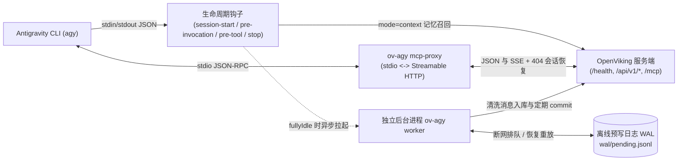

<div align="center">
  
  <h1>agy-openviking</h1>
  <p>零 Node.js 运行时依赖的 Rust 原生插件，将 OpenViking 的 <code>viking://</code> 分层上下文虚拟文件系统与长期记忆桥接至 Google Antigravity CLI（<code>agy</code>）。</p>

  <p>
    <a href="https://github.com/JamCh01/agy-openviking/actions/workflows/ci.yml"></a>
    <a href="https://github.com/JamCh01/agy-openviking/releases"></a>
    <a href="LICENSE"></a>
    <a href="Cargo.toml"></a>
  </p>

  <p>
    <a href="README.md">English</a> | <strong>简体中文</strong> | <a href="README.zh-TW.md">繁體中文</a> | <a href="README.ja.md">日本語</a>
  </p>
</div>

---

## 目录

- [背景](#背景)
- [核心架构与组件](#核心架构与组件)
- [安装](#安装)
- [使用说明与配置](#使用说明与配置)
- [相关项目](#相关项目)
- [维护者与贡献指南](#维护者与贡献指南)
- [许可证](#许可证)

## 背景

[OpenViking](https://github.com/volcengine/OpenViking) 通过统一的 `viking://` 虚拟文件系统管理智能体长期记忆、团队工程文档、可复用技能与编译态架构规则，并提供 **L0（摘要）-> L1（概览）-> L2（全文）** 渐进式上下文分层能力。

`agy-openviking`（`ov-agy`）以**零 Node.js / Python 运行时依赖**的 Rust 单一编译二进制，将 OpenViking 完整桥接至 Google Antigravity CLI（`agy`）的五大扩展支柱（**MCP 服务 + 生命周期钩子 + 异步子 Agent + 技能包 + 常驻规则**）：

- **亚毫秒级同步热路径与降级放行（Fail-Open）**：高频生命周期钩子（`PreToolUse` 与 `Stop`）走零异步运行时开销的同步热路径（`< 1 ms`）；所有钩子统一捕获网络超时与配置异常并以退出码 `0` 返回合法兜底 JSON，确保 OpenViking 离线时绝不阻塞 `agy` 主流程。
- **Prompt Cache 友好的轮次去重保护**：`PreInvocation` 仅尾部定位读取 `transcript.jsonl` 末尾 `64 KiB`，对 `(conversationId, turn_offset, query)` 计算摘要，确保每个用户提问轮次仅触发一次 `mode: "context"` 检索；同一轮工具调用内循环（`invocationNum > 1`）直接零网络开销返回 `{}`，避免破坏大模型前缀缓存。
- **Git Worktree 仓库级 Peer 归一化**：自动解析链式 Git 工作树（`.git` 文件中的 `gitdir:` 与 `commondir`）回溯共享 `.git/config`，将 SSH（`git@github.com:Org/Repo.git`）与 HTTPS（`https://github.com/Org/Repo.git`）远端地址归一化为同一仓库级 `peer` 标识。
- **防记忆自污染采集与离线预写日志（WAL）**：后台独立进程 `ov-agy worker` 在归档对话前自动剥离 `<openviking-context>`、`<openviking-session>` 与 `<available-skills>` 注入块；服务端不可达时通过 `fs4` 文件锁将待写消息持久化至 `wal/pending.jsonl`（上限 `10 MiB`），待服务恢复后自动重放。

## 核心架构与组件

| 组件 | 入口 / 文件路径 | 职责边界 |
| :--- | :--- | :--- |
| **MCP 代理（`mcp-proxy`）** | `ov-agy mcp-proxy`（`mcp_config.json`） | 将标准输入输出 JSON-RPC 2.0 桥接至 Streamable HTTP `POST {base_url}/mcp`，同时兼容 `application/json` 与 `text/event-stream`（SSE）流式响应，并在遇到 HTTP `404` 会话过期时透明重握手恢复 `mcp-session-id`。 |
| **`SessionStart` 生命周期钩子** | `./scripts/ov-agy hook session-start` | 会话启动时探测 `/health` 与 `/api/v1/system/status`，拉取 `viking://~/skills` 与 `viking://agent/skills` 远端技能摘要，一次性注入会话状态上下文。 |
| **`PreInvocation` 生命周期钩子** | `./scripts/ov-agy hook pre-invocation` | 从 `transcript.jsonl` 尾部提取最新用户指令，按用户轮次去重后调用 `POST /api/v1/search/search`（`mode: "context"`）注入 `<openviking-context>`。 |
| **`PreToolUse` 生命周期钩子** | `./scripts/ov-agy hook pre-tool` | `< 1 ms` 同步安全守卫，拦截任何误将 `viking://` 虚拟 URI 传入本地文件工具（`view_file`、`write_to_file`、`replace_file_content`、`multi_replace_file_content`、`list_dir`、`grep_search`）的调用。 |
| **`Stop` 钩子与后台 `worker`** | `./scripts/ov-agy hook stop` -> `ov-agy worker` | 当 `fullyIdle == true` 时以分离模式（`Stdio::null()`）派生后台 `ov-agy worker`；清洗注入标签后写入 `agy-{conversationId}` 会话、按轮次阈值触发 `/commit`，并在故障时读写离线 `wal/pending.jsonl`。 |
| **异步子 Agent** | `agents/viking-navigator.md` | 只读后台检索子 Agent（`inheritMcp: true`，`commandExecutionPolicy: off`），按 L0 -> L1 -> L2 分层探索 `viking://` 知识树并返回带精确 URI 引用的精炼结论，保持主对话上下文精简。 |
| **四大技能（`/ov-*`）** | `skills/*/SKILL.md` | `/ov-doctor`（连通性与离线队列自检）、`/ov-ingest`（外部文档/仓库与技能入库流程）、`/ov-experience`（保留遥测归因的排障经验召回）、`/ov-rule-search`（代码修改前编译态架构规范检索）。 |
| **常驻规则（Rules）** | `rules/openviking-context.md` | 顶部显式声明 `trigger: always_on`，约束模型遵守 `viking://` 虚拟路径边界、`viking://~` 主目录别名寻址、L0 -> L1 -> L2 渐进检索及本地工作区事实优先原则。 |



## 安装

### 前置依赖

1. 已安装 **Google Antigravity CLI（`agy`）**（支持 macOS、Linux、Windows）。
2. 已部署可访问的 **OpenViking 服务端**（本地默认 `http://127.0.0.1:1933` 或远端 HTTPS 实例）。

### 一行命令远程安装

```bash
agy plugin install https://github.com/JamCh01/agy-openviking
```

首次冷启动且本地不存在源码编译产物时，`./scripts/ov-agy` 会自动从 `.antigravity-plugin/plugin.json` 读取 `version` 版本号，在独立的 `mktemp` 临时目录下载对应平台的预编译二进制包（覆盖 `aarch64-apple-darwin`、`x86_64-apple-darwin`、`x86_64-unknown-linux-musl`、`aarch64-unknown-linux-musl`、`x86_64-pc-windows-msvc`），完成 `checksums.txt` 的 **SHA-256** 完整性校验后通过同目录原子重命名（`mv -f`）落盘至 `${PLUGIN_DATA}/bin/ov-agy-v<version>`，避免 `mcp-proxy` 与 `SessionStart` 并发冷启动竞争。

### 中国大陆或受限网络加速下载

若处于中国大陆网络环境、企业内网或受限网络，可通过环境变量 `OPENVIKING_RELEASE_BASE_URL` 指定镜像站或内网制品库前缀（目录内放置对应版本的压缩包与 `checksums.txt`）：

```bash
export OPENVIKING_RELEASE_BASE_URL="https://mirror.example.com/JamCh01/agy-openviking/releases/download/v0.1.0"
```

### 从源码本地构建开发

需要安装稳定版 Rust 工具链（`cargo`，Rust 2021 Edition）：

```bash
git clone https://github.com/JamCh01/agy-openviking.git
cd agy-openviking
cargo build --release
agy plugin validate --strict .
agy plugin install .
```

当插件目录下存在 `target/release/ov-agy`（或 `target/debug/ov-agy`）时，`./scripts/ov-agy` 会优先直接执行本地编译产物，不触发远端下载。

## 使用说明与配置

### 快速配置（`~/.openviking/ovcli.conf`）

创建 `~/.openviking/ovcli.conf`（建议权限 `chmod 600`）连接本地或远端 OpenViking 服务端：

```json
{
  "url": "http://127.0.0.1:1933",
  "api_key": "your-user-or-admin-api-key",
  "plugin": {
    "antigravity": {
      "enabled": true
    }
  }
}
```

> [!WARNING]
> **切勿在 `/mcp` 使用服务端 `server.root_api_key`**：OpenViking 仅允许 `ov.conf` 中的 `server.root_api_key` 调用集群管理接口，访问 `/mcp` 及租户记忆接口会直接返回 `403 Forbidden`。请通过 `ov config` 签发并配置 **User Key**（或租户 **Admin Key**），或在本地 `127.0.0.1:1933` 使用免鉴权开发模式。

### 技能、子 Agent 与命令行自检用法

- **`/ov-doctor`（连通性与配置自检）**：全面检查生效配置来源、脱敏 API Key 状态、Root Key `403` 误配预警、`/health` 延迟、`/mcp` 握手状态、Git `peer` 归一化标识与离线 WAL 积压情况。也可在终端直接运行：
  ```bash
  ./scripts/ov-agy doctor
  ./scripts/ov-agy doctor --json
  ```
- **`/ov-ingest`（知识与技能入库）**：标准化导入外部网页文档、本地规范说明或 Git 仓库至 `viking://resources/...`（调用 `add_resource`），或导入智能体技能包（调用 `add_skill`），并跟踪异步 L0/L1 索引任务完成状态。
- **`/ov-experience`（排障经验检索）**：在故障排查与复杂运维流程中优先调用 `search_experience` 与 `read_experience`，原样传递标准 `viking://` URI，保留 OpenViking 完整召回与消费遥测归因。
- **`/ov-rule-search`（编译态架构规范检索）**：修改陌生模块、公共接口或安全边界前，调用 `rule_search` 检查团队编译态架构规则（核验 `applies_when` 与 `exception` 条件）。
- **委派 `viking-navigator` 子 Agent**：面对跨目录大型文档检索时，可指示 `agy` 委派 `viking-navigator` 子 Agent 按 L0 `.abstract.md` -> L1 `.overview.md` -> L2 原文的顺序异步探索并汇总证据。

### 配置文件与凭证优先级链

当 `OPENVIKING_CREDENTIAL_SOURCE=auto`（默认值）时，`ov-agy` 按以下从高到低的优先级合并配置：

1. **进程环境变量**（`OPENVIKING_*`）
2. **工作区本地私有覆盖**：`<repo>/.openviking/config.local.json`
3. **工作区团队共享配置**：`<repo>/.openviking/config.json`
4. **OpenViking CLI 配置文件**：`~/.openviking/ovcli.conf`（或 `OPENVIKING_CLI_CONFIG_FILE`，支持 `plugin.antigravity.*` 与 `plugin.*`）
5. **OpenViking 服务端配置文件**：`~/.openviking/ov.conf`（或 `OPENVIKING_CONFIG_FILE`，支持 `server.*` 与 `antigravity.*`）
6. **内置默认值**：`http://127.0.0.1:1933`（若未检测到任何配置文件且未显式设置 `OPENVIKING_MEMORY_ENABLED`，插件自动保持静默关闭，零额外开销）。

### 环境变量完整列表

| 环境变量 | 默认值 | 说明 |
| :--- | :--- | :--- |
| `OPENVIKING_MEMORY_ENABLED` | 自动（按配置文件存在性） | 插件总开关（`1`/`true`/`yes`/`on` 开启，`0`/`false`/`no`/`off` 关闭）。 |
| `OPENVIKING_CREDENTIAL_SOURCE` | `auto` | 凭证来源策略：`auto`、`cli`（仅读取配置文件）或 `env`（仅读取环境变量）。 |
| `OPENVIKING_URL` / `OPENVIKING_BASE_URL` | `http://127.0.0.1:1933` | OpenViking HTTP 服务端基础地址。 |
| `OPENVIKING_MCP_URL` | `{base_url}/mcp` | 自定义 Streamable HTTP MCP 端点地址。 |
| `OPENVIKING_API_KEY` / `OPENVIKING_BEARER_TOKEN` | *(空)* | User 或租户 Admin 级别 API Key（同时注入 `Authorization: Bearer` 与 `X-API-Key`）。 |
| `OPENVIKING_ACCOUNT` | *(空)* | 显式覆盖 `X-OpenViking-Account` 请求头。 |
| `OPENVIKING_USER` | *(空)* | 显式覆盖 `X-OpenViking-User` 请求头。 |
| `OPENVIKING_PEER_ID` | 自动（Git 远端或目录名） | 显式覆盖 `X-OpenViking-Actor-Peer` 仓库级 Peer 标识。 |
| `OPENVIKING_HOME` | `~/.openviking` | OpenViking 基础配置与日志根目录。 |
| `OPENVIKING_CLI_CONFIG_FILE` | `~/.openviking/ovcli.conf` | 自定义 `ovcli.conf` 文件路径。 |
| `OPENVIKING_CONFIG_FILE` | `~/.openviking/ov.conf` | 自定义 `ov.conf` 文件路径。 |
| `OPENVIKING_PLUGIN_DATA` / `OPENVIKING_STATE_DIR` | `~/.openviking/agy-plugin` | 会话状态、文件锁、离线 `wal/pending.jsonl` 与预编译二进制缓存目录。 |
| `OPENVIKING_TIMEOUT_MS` | `15000` | HTTP 请求超时时间，单位毫秒（范围 `500`–`300000`）。 |
| `OPENVIKING_AUTO_RECALL` | `true` | 是否在 `PreInvocation` 阶段启用自动上下文记忆召回。 |
| `OPENVIKING_AUTO_CAPTURE` | `true` | 是否在 `Stop` 阶段启用后台对话采集与自动提交。 |
| `OPENVIKING_RECALL_LIMIT` | `6` | 单轮召回的最大上下文条目数（范围 `1`–`50`）。 |
| `OPENVIKING_RECALL_DEDUP_TURNS` | `5` | 服务端跨轮次去重窗口大小（范围 `0`–`20`）。 |
| `OPENVIKING_SCORE_THRESHOLD` | `0.35` | 召回结果最低相关性分数阈值（范围 `0.0`–`1.0`）。 |
| `OPENVIKING_MIN_QUERY_LENGTH` | `3` | 触发记忆召回的最短用户提问字符数（范围 `1`–`64`）。 |
| `OPENVIKING_RECALL_PEER_SCOPE` | `all` | 记忆召回 Peer 过滤范围：`all` 或 `actor`。 |
| `OPENVIKING_RECALL_EXCLUDE_URIS` | *(空)* | 召回时排除的 `viking://` URI 前缀列表（逗号分隔或 JSON 数组）。 |
| `OPENVIKING_RECALL_QUERY_FILTERS` | *(空)* | 召回前应用于查询文本的 `sed` 风格（`s/pat/rep/g`、`d/pat/`、`k/pat/`）或正则过滤规则。 |
| `OPENVIKING_CAPTURE_FILTERS` | *(空)* | 采集前脱敏或丢弃规则（支持 `user:` / `assistant:` 角色前缀）。 |
| `OPENVIKING_CAPTURE_MAX_LENGTH` | `24000` | 单条采集消息最大字符数上限（范围 `200`–`100000`）。 |
| `OPENVIKING_COMMIT_EVERY_TURNS` | `6` | 触发 `POST /api/v1/sessions/{id}/commit` 的未提交轮次阈值（范围 `1`–`1000`）。 |
| `OPENVIKING_DEBUG` | `false` | 开启后向 `OPENVIKING_DEBUG_LOG` 追加 JSONL 诊断日志（绝不写入 `stdout`）。 |
| `OPENVIKING_DEBUG_LOG` | `~/.openviking/logs/agy.jsonl` | 开启调试模式时的 JSONL 诊断日志路径。 |
| `OPENVIKING_RELEASE_BASE_URL` | GitHub Releases 地址 | `scripts/fetch-binary.sh` 拉取预编译二进制包时的自定义下载前缀。 |

## 相关项目

- [volcengine/OpenViking](https://github.com/volcengine/OpenViking) — 面向 AI Agent 的开源上下文数据库，提供 `viking://` L0/L1/L2 虚拟文件系统、会话记忆提炼与 Streamable HTTP MCP 服务。
- [Google Antigravity 官方文档](https://antigravity.google/docs) — Antigravity CLI（`agy`）插件、生命周期钩子、MCP 服务、子 Agent、技能与规则扩展规范文档。
- [通信协议契约说明](docs/WIRE_CONTRACT.md) — `ov-agy` 实现的 OpenViking REST、Streamable HTTP MCP 与 Antigravity 钩子 JSON 协议明细。

## 维护者与贡献指南

本项目由 [@JamCh01](https://github.com/JamCh01) 维护。欢迎通过 [GitHub Issues](https://github.com/JamCh01/agy-openviking/issues) 反馈问题或提交 [Pull Request](https://github.com/JamCh01/agy-openviking/pulls)。

提交代码前请在本地运行完整质量门禁：

```bash
cargo fmt --check
cargo clippy --all-targets -- -D warnings
cargo test
agy plugin validate --strict .
```

Rust 代码遵循 [Google Rust Style Guide](https://google.github.io/styleguide/rustguide.html)，Git 提交信息遵循 [Angular Commit Message Guidelines](https://github.com/angular/angular/blob/main/contributing-docs/commit-message-guidelines.md)。

## 许可证

本仓库基于 [Apache License, Version 2.0](LICENSE) 开源许可发布。

`agy-openviking`（`ov-agy`）是独立的纯外部客户端实现，严格且仅通过公开文档化的 HTTP REST（`/health`、`/api/v1/*`）与 Streamable HTTP MCP（`/mcp`）协议与 OpenViking 服务端通信，不包含、不静态链接亦不衍生分发服务端内部源码。
