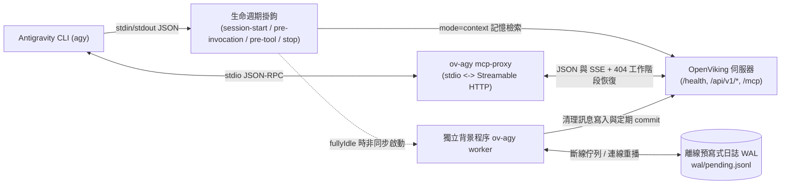

<div align="center">
  
  <h1>agy-openviking</h1>
  <p>零 Node.js 執行環境依賴的 Rust 原生外掛，將 OpenViking 的 <code>viking://</code> 分層脈絡虛擬檔案系統與長期記憶完整橋接至 Google Antigravity CLI（<code>agy</code>）。</p>

  <p>
    <a href="https://github.com/JamCh01/agy-openviking/actions/workflows/ci.yml"></a>
    <a href="https://github.com/JamCh01/agy-openviking/releases"></a>
    <a href="LICENSE"></a>
    <a href="Cargo.toml"></a>
  </p>

  <p>
    <a href="README.md">English</a> | <a href="README.zh-CN.md">简体中文</a> | <strong>繁體中文</strong> | <a href="README.ja.md">日本語</a>
  </p>
</div>

---

## 目錄

- [背景](#背景)
- [核心架構與元件](#核心架構與元件)
- [安裝](#安裝)
- [使用說明與設定](#使用說明與設定)
- [相關專案](#相關專案)
- [維護者與貢獻指南](#維護者與貢獻指南)
- [授權條款](#授權條款)

## 背景

[OpenViking](https://github.com/volcengine/OpenViking) 透過統一的 `viking://` 虛擬檔案系統管理 AI 代理人的長期記憶、團隊技術文件、可重用技能與編譯態架構規範，並提供 **L0（摘要）-> L1（概覽）-> L2（完整內文）** 的漸進式脈絡分層機制。

`agy-openviking`（`ov-agy`）以**零 Node.js / Python 執行環境依賴**的單一 Rust 原生執行檔，將 OpenViking 完整整合至 Google Antigravity CLI（`agy`）的五大擴充支柱（**MCP 伺服器 + 生命週期掛鉤 + 非同步子代理 + 技能套件 + 常駐規則**）：

- **亞毫秒級同步熱路徑與安全放行（Fail-Open）**：高頻率的生命週期掛鉤（`PreToolUse` 與 `Stop`）採用零非同步執行期開銷的同步路徑（`< 1 ms`）；所有掛鉤皆會攔截網路逾時與設定異常，並以結束代碼 `0` 回傳合法的保底 JSON，確保 OpenViking 離線時絕不卡住 `agy` 主程序。
- **保護 Prompt 快取的輪次去重機制**：`PreInvocation` 僅從尾部讀取 `transcript.jsonl` 末端 `64 KiB`，對 `(conversationId, turn_offset, query)` 計算雜湊值，確保每個使用者提問輪次僅發送一次 `mode: "context"` 檢索；同一輪次內的工具呼叫迴圈（`invocationNum > 1`）直接以零網路開銷回傳 `{}`，避免破壞大型語言模型的前綴快取（Prompt Cache）。
- **Git Worktree 儲存庫層級 Peer 正規化**：自動解析連結式 Git 工作樹（`.git` 檔案內的 `gitdir:` 與 `commondir`）回溯共用的 `.git/config`，將 SSH（`git@github.com:Org/Repo.git`）與 HTTPS（`https://github.com/Org/Repo.git`）遠端網址正規化為相同的儲存庫 `peer` 識別碼。
- **防記憶自我污染擷取與離線預寫式日誌（WAL）**：背景獨立程序 `ov-agy worker` 在寫入對話紀錄前會自動清除 `<openviking-context>`、`<openviking-session>` 與 `<available-skills>` 注入區塊；當伺服器無法連線時，透過 `fs4` 檔案鎖定將待傳送資料寫入離線佇列 `wal/pending.jsonl`（上限 `10 MiB`），待連線恢復後自動重播。

## 核心架構與元件

| 元件 | 進入點 / 檔案路徑 | 職責邊界 |
| :--- | :--- | :--- |
| **MCP 代理（`mcp-proxy`）** | `ov-agy mcp-proxy`（`mcp_config.json`） | 將標準輸入輸出 JSON-RPC 2.0 橋接至 Streamable HTTP `POST {base_url}/mcp`，支援 `application/json` 與 `text/event-stream`（SSE）串流回應，並在遇到 HTTP `404` 工作階段失效時自動重新交握恢復 `mcp-session-id`。 |
| **`SessionStart` 生命週期掛鉤** | `./scripts/ov-agy hook session-start` | 對談啟動時探測 `/health` 與 `/api/v1/system/status`，探索 `viking://~/skills` 與 `viking://agent/skills` 遠端技能摘要，一次性注入工作階段狀態。 |
| **`PreInvocation` 生命週期掛鉤** | `./scripts/ov-agy hook pre-invocation` | 從 `transcript.jsonl` 尾端擷取最新使用者輸入，完成輪次去重後呼叫 `POST /api/v1/search/search`（`mode: "context"`）注入 `<openviking-context>`。 |
| **`PreToolUse` 生命週期掛鉤** | `./scripts/ov-agy hook pre-tool` | `< 1 ms` 同步安全閘門，攔截任何誤將 `viking://` 虛擬 URI 傳入本機檔案工具（`view_file`、`write_to_file`、`replace_file_content`、`multi_replace_file_content`、`list_dir`、`grep_search`）的呼叫。 |
| **`Stop` 掛鉤與背景 `worker`** | `./scripts/ov-agy hook stop` -> `ov-agy worker` | 當 `fullyIdle == true` 時以分離模式（`Stdio::null()`）啟動背景 `ov-agy worker`；清理注入標籤後寫入 `agy-{conversationId}` 工作階段、依輪次門檻觸發 `/commit`，並於斷線時讀寫離線 `wal/pending.jsonl`。 |
| **非同步子代理（Subagent）** | `agents/viking-navigator.md` | 唯讀背景檢索子代理（`inheritMcp: true`，`commandExecutionPolicy: off`），依循 L0 -> L1 -> L2 漸進探索 `viking://` 知識樹並回傳附帶精確 URI 引用的摘要，避免撐爆主對話視窗。 |
| **四大技能（`/ov-*`）** | `skills/*/SKILL.md` | `/ov-doctor`（連線與離線佇列診斷）、`/ov-ingest`（外部文件/儲存庫與技能匯入標準程序）、`/ov-experience`（保留遙測歸因的除錯經驗檢索）、`/ov-rule-search`（修改程式碼前的編譯態架構規範檢索）。 |
| **常駐規則（Rules）** | `rules/openviking-context.md` | 頂部明確設定 `trigger: always_on`，強制遵守 `viking://` 虛擬路徑邊界、`viking://~` 家目錄別名定址、L0 -> L1 -> L2 漸進式檢索與本機工作區程式碼優先原則。 |



## 安裝

### 前置需求

1. 已安裝 **Google Antigravity CLI（`agy`）**（支援 macOS、Linux、Windows）。
2. 已啟動可連線的 **OpenViking 伺服器**（本機預設 `http://127.0.0.1:1933` 或遠端 HTTPS 服務）。

### 一行指令遠端安裝

```bash
agy plugin install https://github.com/JamCh01/agy-openviking
```

首次冷啟動且本機不含原始碼建置產物時，`./scripts/ov-agy` 會自動讀取 `.antigravity-plugin/plugin.json` 中的 `version` 欄位，在獨立的 `mktemp` 暫存目錄下載對應平台的預編譯二進位壓縮檔（支援 `aarch64-apple-darwin`、`x86_64-apple-darwin`、`x86_64-unknown-linux-musl`、`aarch64-unknown-linux-musl`、`x86_64-pc-windows-msvc`），完成 `checksums.txt` 的 **SHA-256** 雜湊驗證後，以同目錄原子重新命名（`mv -f`）部署至 `${PLUGIN_DATA}/bin/ov-agy-v<version>`，防止 `mcp-proxy` 與 `SessionStart` 並行冷啟動時發生競爭衝突。

### 受限網路或鏡像站加速下載

在受限企業內網或連線 GitHub Releases 較慢的環境中，可透過環境變數 `OPENVIKING_RELEASE_BASE_URL` 覆寫下載前綴（鏡像路徑下放置對應版本的壓縮檔與 `checksums.txt`）：

```bash
export OPENVIKING_RELEASE_BASE_URL="https://mirror.example.com/JamCh01/agy-openviking/releases/download/v0.1.0"
```

### 從原始碼本機建置開發

需安裝穩定版 Rust 工具鏈（`cargo`，Rust 2021 Edition）：

```bash
git clone https://github.com/JamCh01/agy-openviking.git
cd agy-openviking
cargo build --release
agy plugin validate --strict .
agy plugin install .
```

當外掛目錄下存在 `target/release/ov-agy`（或 `target/debug/ov-agy`）執行檔時，`./scripts/ov-agy` 會優先直接執行本機建置產物，不會觸發網路下載。

## 使用說明與設定

### 快速設定（`~/.openviking/ovcli.conf`）

建立 `~/.openviking/ovcli.conf`（建議設定檔案權限 `chmod 600`）指向 OpenViking 伺服器：

```json
{
  "url": "http://127.0.0.1:1933",
  "api_key": "your-user-or-admin-api-key",
  "plugin": {
    "antigravity": {
      "enabled": true
    }
  }
}
```

> [!WARNING]
> **切勿在 `/mcp` 使用伺服器的 `server.root_api_key`**：OpenViking 僅允許 `ov.conf` 內的 `server.root_api_key` 存取叢集管理介面，用於 `/mcp` 或租戶記憶端點會直接回傳 `403 Forbidden`。請透過 `ov config` 建立並設定 **User Key**（或租戶 **Admin Key**），或於本機 `127.0.0.1:1933` 使用免驗證模式。

### 技能、子代理與終端機自我檢測

- **`/ov-doctor`（連線與設定診斷）**：檢查實際生效的設定來源、遮罩處理後的 API Key 狀態、Root Key `403` 誤設警告、`/health` 回應延遲、`/mcp` 交握狀態、Git `peer` 正規化識別碼與離線 WAL 佇列筆數。亦可直接於終端機執行：
  ```bash
  ./scripts/ov-agy doctor
  ./scripts/ov-agy doctor --json
  ```
- **`/ov-ingest`（知識與技能匯入）**：引導將外部網頁文件、本機規格書或 Git 儲存庫匯入至 `viking://resources/...`（呼叫 `add_resource`），或封裝匯入技能套件（呼叫 `add_skill`），並追蹤非同步 L0/L1 索引進度。
- **`/ov-experience`（除錯經驗檢索）**：於錯誤排查與複雜維運作業時優先呼叫 `search_experience` 與 `read_experience`，原封不動傳遞標準 `viking://` URI，完整保留 OpenViking 的檢索與採用遙測紀錄。
- **`/ov-rule-search`（編譯態架構規範檢索）**：修改不熟悉的模組、公開介面或權限邊界前，透過 `rule_search` 查詢團隊編譯態架構規範（檢核 `applies_when` 與 `exception` 條件）。
- **委派 `viking-navigator` 子代理**：需要跨目錄檢視大量架構文件時，可請 `agy` 委派 `viking-navigator` 子代理依序讀取 L0 `.abstract.md` 與 L1 `.overview.md`，再精準讀取關鍵 L2 全文並回報濃縮結論。

### 設定檔與憑證優先順序鏈

當 `OPENVIKING_CREDENTIAL_SOURCE=auto`（預設值）時，`ov-agy` 會依下列由高至低的優先順序載入設定：

1. **程序環境變數**（`OPENVIKING_*`）
2. **工作區本機私有覆寫**：`<repo>/.openviking/config.local.json`
3. **工作區團隊共用設定**：`<repo>/.openviking/config.json`
4. **OpenViking CLI 設定檔**：`~/.openviking/ovcli.conf`（或 `OPENVIKING_CLI_CONFIG_FILE`，支援 `plugin.antigravity.*` 與 `plugin.*`）
5. **OpenViking 伺服器設定檔**：`~/.openviking/ov.conf`（或 `OPENVIKING_CONFIG_FILE`，支援 `server.*` 與 `antigravity.*`）
6. **內建預設值**：`http://127.0.0.1:1933`（若未偵測到任何設定檔且未設定 `OPENVIKING_MEMORY_ENABLED`，外掛將自動維持靜默停用，零額外資源消耗）。

### 環境變數完整參考表

| 環境變數 | 預設值 | 說明 |
| :--- | :--- | :--- |
| `OPENVIKING_MEMORY_ENABLED` | 自動（依設定檔是否存在） | 外掛總開關（`1`/`true`/`yes`/`on` 啟用，`0`/`false`/`no`/`off` 停用）。 |
| `OPENVIKING_CREDENTIAL_SOURCE` | `auto` | 憑證來源策略：`auto`、`cli`（僅讀取設定檔）或 `env`（僅讀取環境變數）。 |
| `OPENVIKING_URL` / `OPENVIKING_BASE_URL` | `http://127.0.0.1:1933` | OpenViking HTTP 伺服器基礎網址。 |
| `OPENVIKING_MCP_URL` | `{base_url}/mcp` | 覆寫 Streamable HTTP MCP 端點網址。 |
| `OPENVIKING_API_KEY` / `OPENVIKING_BEARER_TOKEN` | *(空)* | User 或租戶 Admin 等級 API Key（同時帶入 `Authorization: Bearer` 與 `X-API-Key`）。 |
| `OPENVIKING_ACCOUNT` | *(空)* | 明確覆寫 `X-OpenViking-Account` 標頭。 |
| `OPENVIKING_USER` | *(空)* | 明確覆寫 `X-OpenViking-User` 標頭。 |
| `OPENVIKING_PEER_ID` | 自動（Git 遠端網址或目錄名） | 明確覆寫 `X-OpenViking-Actor-Peer` 儲存庫 Peer 識別碼。 |
| `OPENVIKING_HOME` | `~/.openviking` | OpenViking 設定檔與日誌根目錄。 |
| `OPENVIKING_CLI_CONFIG_FILE` | `~/.openviking/ovcli.conf` | 自訂 `ovcli.conf` 設定檔路徑。 |
| `OPENVIKING_CONFIG_FILE` | `~/.openviking/ov.conf` | 自訂 `ov.conf` 設定檔路徑。 |
| `OPENVIKING_PLUGIN_DATA` / `OPENVIKING_STATE_DIR` | `~/.openviking/agy-plugin` | 儲存工作階段狀態、檔案鎖定、離線 `wal/pending.jsonl` 與快取執行檔的資料目錄。 |
| `OPENVIKING_TIMEOUT_MS` | `15000` | HTTP 請求逾時毫秒數（範圍 `500`–`300000`）。 |
| `OPENVIKING_AUTO_RECALL` | `true` | 是否於 `PreInvocation` 階段啟用自動脈絡記憶檢索。 |
| `OPENVIKING_AUTO_CAPTURE` | `true` | 是否於 `Stop` 階段啟用背景對話擷取與自動提交。 |
| `OPENVIKING_RECALL_LIMIT` | `6` | 單輪檢索回傳的最大脈絡筆數（範圍 `1`–`50`）。 |
| `OPENVIKING_RECALL_DEDUP_TURNS` | `5` | 伺服器端跨輪次去重視窗大小（範圍 `0`–`20`）。 |
| `OPENVIKING_SCORE_THRESHOLD` | `0.35` | 檢索結果最低相關性分數門檻（範圍 `0.0`–`1.0`）。 |
| `OPENVIKING_MIN_QUERY_LENGTH` | `3` | 觸發記憶檢索的最短使用者提問字元數（範圍 `1`–`64`）。 |
| `OPENVIKING_RECALL_PEER_SCOPE` | `all` | 記憶檢索 Peer 過濾範圍：`all` 或 `actor`。 |
| `OPENVIKING_RECALL_EXCLUDE_URIS` | *(空)* | 檢索時排除的 `viking://` URI 前綴清單（逗號分隔或 JSON 陣列）。 |
| `OPENVIKING_RECALL_QUERY_FILTERS` | *(空)* | 檢索前套用至查詢字串的 `sed` 風格（`s/pat/rep/g`、`d/pat/`、`k/pat/`）或正規表示式過濾規則。 |
| `OPENVIKING_CAPTURE_FILTERS` | *(空)* | 擷取前遮罩或丟棄訊息的過濾規則（支援 `user:` / `assistant:` 角色前綴）。 |
| `OPENVIKING_CAPTURE_MAX_LENGTH` | `24000` | 單則擷取訊息的最大字元數上限（範圍 `200`–`100000`）。 |
| `OPENVIKING_COMMIT_EVERY_TURNS` | `6` | 觸發 `POST /api/v1/sessions/{id}/commit` 的未提交輪次門檻（範圍 `1`–`1000`）。 |
| `OPENVIKING_DEBUG` | `false` | 啟用後將結構化診斷事件寫入 `OPENVIKING_DEBUG_LOG`（絕不污染 `stdout`）。 |
| `OPENVIKING_DEBUG_LOG` | `~/.openviking/logs/agy.jsonl` | 啟用除錯模式時的 JSONL 診斷日誌路徑。 |
| `OPENVIKING_RELEASE_BASE_URL` | GitHub Releases 網址 | `scripts/fetch-binary.sh` 下載預編譯執行檔時的自訂鏡像網址前綴。 |

## 相關專案

- [volcengine/OpenViking](https://github.com/volcengine/OpenViking) — 專為 AI 代理人打造的開源脈絡資料庫，提供 `viking://` L0/L1/L2 虛擬檔案系統、工作階段記憶萃取與 Streamable HTTP MCP 伺服器。
- [Google Antigravity 官方文件](https://antigravity.google/docs) — Antigravity CLI（`agy`）外掛、生命週期掛鉤、MCP 伺服器、子代理、技能與規則擴充開發文件。
- [通訊協定規格書](docs/WIRE_CONTRACT.md) — `ov-agy` 實作的 OpenViking REST、Streamable HTTP MCP 與 Antigravity 掛鉤 JSON 傳輸契約細節。

## 維護者與貢獻指南

本專案由 [@JamCh01](https://github.com/JamCh01) 維護。歡迎透過 [GitHub Issues](https://github.com/JamCh01/agy-openviking/issues) 回報問題或提交 [Pull Request](https://github.com/JamCh01/agy-openviking/pulls)。

提交變更前請先於本機執行完整驗證流程：

```bash
cargo fmt --check
cargo clippy --all-targets -- -D warnings
cargo test
agy plugin validate --strict .
```

Rust 程式碼遵循 [Google Rust Style Guide](https://google.github.io/styleguide/rustguide.html)，Git 提交訊息遵循 [Angular Commit Message Guidelines](https://github.com/angular/angular/blob/main/contributing-docs/commit-message-guidelines.md)。

## 授權條款

本儲存庫採用 [Apache License, Version 2.0](LICENSE) 開源授權條款釋出。

`agy-openviking`（`ov-agy`）為獨立開發的純外部用戶端實作，嚴格且僅透過公開文件定義的 HTTP REST（`/health`、`/api/v1/*`）與 Streamable HTTP MCP（`/mcp`）協定與 OpenViking 伺服器通訊，不包含、不連結亦不重新散佈伺服器端內部原始碼。
