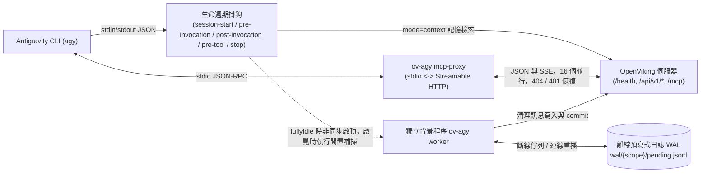

<div align="center">
  
  <h1>agy-openviking</h1>
  <p>零 Node.js 執行環境依賴的 Rust 原生外掛，將 OpenViking 的 <code>viking://</code> 分層脈絡虛擬檔案系統與長期記憶完整橋接至 Google Antigravity CLI（<code>agy</code>）。</p>

  <p>
    <a href="https://github.com/JamCh01/agy-openviking/actions/workflows/ci.yml"></a>
    <a href="https://github.com/JamCh01/agy-openviking/releases"></a>
    <a href="LICENSE"></a>
    <a href="Cargo.toml"></a>
  </p>

  <p>
    <a href="README.md">English</a> | <a href="README.zh-CN.md">简体中文</a> | <strong>繁體中文</strong> | <a href="README.ja.md">日本語</a>
  </p>
</div>

---

## 目錄

- [背景](#背景)
- [核心架構與元件](#核心架構與元件)
- [安裝](#安裝)
- [使用說明與設定](#使用說明與設定)
- [相關專案](#相關專案)
- [維護者與貢獻指南](#維護者與貢獻指南)
- [授權條款](#授權條款)

## 背景

[OpenViking](https://github.com/volcengine/OpenViking) 透過統一的 `viking://` 虛擬檔案系統管理 AI 代理人的長期記憶、團隊技術文件、可重用技能與編譯態架構規範，並提供 **L0（摘要）-> L1（概覽）-> L2（完整內文）** 的漸進式脈絡分層機制。

`agy-openviking`（`ov-agy`）以**零 Node.js / Python 執行環境依賴**的單一 Rust 原生執行檔，將 OpenViking 完整整合至 Google Antigravity CLI（`agy`）的五大擴充支柱（**MCP 伺服器 + 生命週期掛鉤 + 非同步子代理 + 技能套件 + 常駐規則**）：

- **亞毫秒級同步熱路徑與安全放行（Fail-Open）**：高頻率的生命週期掛鉤（`PreToolUse` 與 `Stop`）採用零非同步執行期開銷的同步路徑（`< 1 ms`）；所有掛鉤皆會攔截網路逾時與設定異常，並以結束代碼 `0` 回傳合法的保底 JSON，確保 OpenViking 離線時絕不卡住 `agy` 主程序。
- **依使用者輪次去重。** 首次模型呼叫依當前提問和對話步驟檢索。工具迴圈（`invocationNum > 0`）和模型回覆後的背景喚醒會跳過檢索。
- **Git Worktree 儲存庫層級 Peer 正規化**：自動解析連結式 Git 工作樹（`.git` 檔案內的 `gitdir:` 與 `commondir`）回溯共用的 `.git/config`，將 SSH（`git@github.com:Org/Repo.git`）與 HTTPS（`https://github.com/Org/Repo.git`）遠端網址正規化為相同的儲存庫 `peer` 識別碼。
- **防記憶自我污染擷取與離線預寫式日誌（WAL）**：背景獨立程序 `ov-agy worker` 在寫入對話紀錄前會自動清除 `<openviking-context>`、`<openviking-session>` 與 `<available-skills>` 注入區塊；當伺服器無法連線時，透過 `fs4` 檔案鎖定將待傳送資料寫入離線佇列 `wal/<scope>/pending.jsonl`（上限 `10 MiB`），待連線恢復後自動重播。

## 核心架構與元件

| 元件 | 進入點 / 檔案路徑 | 職責邊界 |
| :--- | :--- | :--- |
| **MCP 代理（`mcp-proxy`）** | `ov-agy mcp-proxy`（`mcp_config.json`） | 透過 MCP `roots/list` 取得 agy 工作區，將 JSON/SSE 請求轉送至 `{base_url}/mcp`，最多同時 16 個請求：回應可能亂序送回，`initialize` 與通知則維持原順序。工作階段過期回傳 HTTP 404 時重新交握。收到 401/403 後，代理會重新讀取 `ovcli.conf` 與 `ov.conf`；若內容有變更（`ov config switch`、`ov-agy setup`），就改用新金鑰重新連線一次。請求超過 60 秒逾時限制時，回傳 JSON-RPC 錯誤 `-32004`。 |
| **`SessionStart` 生命週期掛鉤** | `sh ./scripts/ov-agy hook session-start` | 檢查連線，注入 `<openviking-session>` 狀態區塊與 `<openviking-context source="startup">`：使用者與專案設定檔、記憶索引和技能清單，大小受 `sessionStartMaxBytes` 限制。同時啟動閒置補掃。 |
| **`PreInvocation` 生命週期掛鉤** | `sh ./scripts/ov-agy hook pre-invocation` | 使用 `lastUserInput` 和對話紀錄辨識當前輪次，優先讀取 `transcript_full.jsonl`，按程式開發情境檢索。執行 `/compact` 後會再次注入啟動區塊（`source="compaction"`）並提交工作階段。 |
| **`PostInvocation` 生命週期掛鉤** | `sh ./scripts/ov-agy hook post-invocation` | 在一輪對話給出最終回答後，顯示一行僅供使用者查看的文字，列出該輪用到的 OpenViking 來源，例如 `OpenViking · 3 sources · 2 memories · 1 read`（`usageView`）。模型看不到這一行。 |
| **`PreToolUse` 生命週期掛鉤** | `sh ./scripts/ov-agy hook pre-tool` | 攔截路徑以 `viking://` 起始的本機檔案操作。檔案內文與搜尋條件可以引用此 URI。其他呼叫一律回傳 `ask`，交由 agy 原本的權限流程處理（agy 會拒絕沒有 decision 的回覆，而 `allow` 會繞過你自己的權限規則）。 |
| **`Stop` 掛鉤與背景 `worker`** | `sh ./scripts/ov-agy hook stop` -> `ov-agy worker` | 閒置時將已完成的訊息以每批 100 則寫入 `agy-{conversationId}`：內文原樣送出，每個工具呼叫與其結果配成一個 `tool` part。伺服器待提交 token 達到 `commitTokenThreshold` 時才提交，重播目前身分的離線佇列，並將本次處理記錄於 `last-capture.json`。 |
| **閒置補掃（Idle Sweep）** | `ov-agy sweep`（由 `SessionStart` 啟動） | agy 沒有 `SessionEnd`，因此新工作階段啟動時會提交已閒置 30 分鐘的對話、重播離線佇列，並清除超過 30 天的狀態。 |
| **指令（Commands）** | `scripts/ov-agy doctor` / `status` / `setup` | `doctor` 檢查安裝、設定、伺服器與近期活動；`status` 顯示外掛目前正在做什麼；`setup` 將驗證過的網址與金鑰寫入 `ovcli.conf`。 |
| **非同步子代理（Subagent）** | `agents/viking-navigator.md` | 唯讀背景檢索子代理（`inheritMcp: true`，`commandExecutionPolicy: off`），依循 L0 -> L1 -> L2 漸進探索 `viking://` 知識樹並回傳附帶精確 URI 引用的摘要，避免撐爆主對話視窗。 |
| **技能（Skills）** | `skills/*/SKILL.md` | `openviking-memory`（選擇檢索工具、何時寫入）、`openviking-skills`（已儲存的技能）、`/ov-doctor`（診斷）、`/ov-ingest`（資源與技能匯入）、`/ov-experience`（經驗檢索）與 `/ov-rule-search`（編譯態規範）。 |
| **常駐規則（Rules）** | `rules/openviking-context.md` | 頂部明確設定 `trigger: always_on`，強制遵守 `viking://` 虛擬路徑邊界、`viking://~` 家目錄別名定址、L0 -> L1 -> L2 漸進式檢索與本機工作區程式碼優先原則。 |

在 agy 1.5.16 中，ACP 的 `session/load` 會還原對話紀錄，且不會再次觸發 `SessionStart`。下次提問仍會進行語意檢索，擷取則從上次儲存的位置繼續。



## 安裝

### 前置需求

1. 已在 macOS 或 Linux 上安裝 **Google Antigravity CLI（`agy`）**。Windows 尚未測試：掛鉤與 MCP 伺服器都以 `sh ./scripts/ov-agy` 啟動，因此 Git for Windows 提供的 `sh` 必須在 `PATH` 中（安裝 Git for Windows 時，請選擇「Use Git and optional Unix tools from the Command Prompt」）。
2. 已啟動可連線的 **OpenViking 伺服器**（本機預設 `http://127.0.0.1:1933` 或遠端 HTTPS 服務）。`ov-agy` 以 rustls 檢查 TLS，信任內建的 Mozilla 根憑證與作業系統的憑證存放區（macOS 鑰匙圈、Linux CA 憑證包、Windows 憑證存放區；設定 `SSL_CERT_FILE` / `SSL_CERT_DIR` 時改用其指定的憑證）。私有 CA 不在系統憑證存放區時，請將 `OPENVIKING_CA_CERTS` 指向其 PEM 檔案。

### 一行指令遠端安裝

```bash
agy plugin install https://github.com/JamCh01/agy-openviking
```

agy 的 `/plugin` 市集只列出 Google 精選的目錄，因此本外掛請從其 GitHub 儲存庫安裝（或從本機目錄安裝，見下文）。

首次冷啟動且本機不含原始碼建置產物時，`./scripts/ov-agy` 會自動讀取 `.antigravity-plugin/plugin.json` 中的 `version` 欄位，在獨立的 `mktemp` 暫存目錄下載對應平台的預編譯二進位壓縮檔（支援 `aarch64-apple-darwin`、`x86_64-apple-darwin`、`x86_64-unknown-linux-musl`、`aarch64-unknown-linux-musl`、`x86_64-pc-windows-msvc`），完成 `checksums.txt` 的 **SHA-256** 雜湊驗證後，以同目錄原子重新命名（`mv -f`）部署至 `${PLUGIN_DATA}/bin/ov-agy-v<version>`，防止 `mcp-proxy` 與 `SessionStart` 並行冷啟動時發生競爭衝突。MCP 伺服器啟動時會等待下載完成，掛鉤不會：`PreToolUse` 掛鉤逾時會讓 agy 直接判定工具呼叫失敗，因此在二進位檔快取完成前，掛鉤一律立即回覆（`PreToolUse` 回傳 `ask`，其餘回傳 `{}`），並只在背景發起一次下載。

### 受限網路或鏡像站加速下載

在受限企業內網或連線 GitHub Releases 較慢的環境中，可透過環境變數 `OPENVIKING_RELEASE_BASE_URL` 覆寫下載前綴（鏡像路徑下放置對應版本的壓縮檔與 `checksums.txt`）：

```bash
export OPENVIKING_RELEASE_BASE_URL="https://mirror.example.com/JamCh01/agy-openviking/releases/download/v0.2.0"
```

### 從原始碼本機建置開發

需安裝穩定版 Rust 工具鏈（`cargo`，Rust 2021 Edition）：

```bash
git clone https://github.com/JamCh01/agy-openviking.git
cd agy-openviking
cargo build --release
agy plugin validate --strict .
agy plugin install .
```

當外掛目錄下存在 `target/release/ov-agy`（或 `target/debug/ov-agy`）執行檔時，`./scripts/ov-agy` 會優先直接執行本機建置產物，不會觸發網路下載。

## 使用說明與設定

### 快速設定（`~/.openviking/ovcli.conf`）

外掛的設定指令會詢問網址與金鑰，向伺服器驗證（可連線、金鑰被接受、並非 root key），再合併寫入 `~/.openviking/ovcli.conf`，並將原有檔案保留為 `ovcli.conf.bak-<time>`；兩個檔案的權限皆為 0600：

```bash
~/.gemini/config/plugins/openviking/scripts/ov-agy setup
# without prompts, keeping the key out of shell history:
printf '%s\n' "$OV_KEY" | ~/.gemini/config/plugins/openviking/scripts/ov-agy setup --url https://ov.example.com --api-key-stdin --yes
```

`--dry-run` 會顯示合併後的檔案（金鑰已遮罩），`--no-verify` 則略過伺服器檢查。OpenViking CLI 的 `ov config` 寫入的也是同一個檔案。若要手動撰寫，請建立 `~/.openviking/ovcli.conf`（建議設定檔案權限 `chmod 600`）指向 OpenViking 伺服器：

```json
{
  "url": "http://127.0.0.1:1933",
  "api_key": "your-user-or-admin-api-key",
  "plugin": {
    "antigravity": {
      "enabled": true
    }
  }
}
```

> [!WARNING]
> **切勿在 `/mcp` 使用伺服器的 `server.root_api_key`**：OpenViking 僅允許 `ov.conf` 內的 `server.root_api_key` 存取叢集管理介面，用於 `/mcp` 或租戶記憶端點會直接回傳 `403 Forbidden`。請透過 `ov config` 建立並設定 **User Key**（或租戶 **Admin Key**），或於本機 `127.0.0.1:1933` 使用免驗證模式。

### 技能、子代理與終端機自我檢測

- **`/ov-doctor`（連線與設定診斷）**：執行 `ov-agy doctor`，依 ok/info/warn/fail 等級回報檢查結果，每個問題都附上修正方式，內容分為四個部分：外掛安裝（manifest、掛鉤、啟動器、MCP 設定項目、agy 中的啟用狀態）、設定（來源、網址格式檢查、遮罩後的金鑰、root key 防護、peer、開關、代理伺服器變數、TLS 根憑證）、伺服器（`/health` 及金鑰所對應的身分、`/ready`、`/api/v1/system/status`、讀取 `viking://~/memories`、MCP `tools/list`），以及近期活動（最近一次注入、檢索與擷取、離線佇列、除錯日誌中的掛鉤錯誤）。供人閱讀的報告在有檢查失敗時以結束代碼 1 結束；`--json` 一律以結束代碼 0 結束，並在輸出中帶有 `ok` 欄位。`ov-agy status` 則改為輸出一個畫面可容納的摘要。亦可直接於終端機執行：
  ```bash
  ~/.gemini/config/plugins/openviking/scripts/ov-agy doctor
  ~/.gemini/config/plugins/openviking/scripts/ov-agy doctor --json
  ~/.gemini/config/plugins/openviking/scripts/ov-agy status
  ```
- **`openviking-memory` 與 `openviking-skills`**：由模型自行呼叫的技能，與 Codex、Claude Code 外掛一致。前者涵蓋如何在脈絡搜尋、`find`、列表搜尋與 `grep` 之間選擇、讀取 `viking://` URI、何時該（或不該）寫入，以及記憶歸檔的位置；後者涵蓋尋找、使用、建立、分享與遷移儲存在 OpenViking 中的技能。
- **`/ov-ingest`（知識與技能匯入）**：引導將外部網頁文件、本機規格書或 Git 儲存庫匯入至 `viking://resources/...`（呼叫 `add_resource`），或封裝匯入技能套件（呼叫 `add_skill`），並追蹤非同步 L0/L1 索引進度。
- **`/ov-experience`（除錯經驗檢索）**：以 `find` 或 `search` 檢索 `viking://~/memories/experiences`，再用 `read` 讀取最多三筆相符經驗的完整內文，原封不動傳遞標準 `viking://` URI。
- **`/ov-rule-search`（編譯態架構規範檢索）**：修改不熟悉的模組、公開介面或權限邊界前，透過 `rule_search` 查詢團隊編譯態架構規範（檢核 `applies_when` 與 `exception` 條件）；若傳回結果不完整（`delivery.complete: false`），行動前會先讀取遺漏的規範。
- **委派 `viking-navigator` 子代理**：需要跨目錄檢視大量架構文件時，可請 `agy` 委派 `viking-navigator` 子代理依序讀取 L0 `.abstract.md` 與 L1 `.overview.md`，再精準讀取關鍵 L2 全文並回報濃縮結論。

### 設定檔與憑證優先順序鏈

當 `OPENVIKING_CREDENTIAL_SOURCE=auto`（預設值）時，`ov-agy` 會依下列由高至低的優先順序載入設定：

1. **程序環境變數**（`OPENVIKING_*`）
2. **工作區本機私有覆寫**：`<repo>/.openviking/config.local.json`
3. **工作區團隊共用設定**：`<repo>/.openviking/config.json`
4. **OpenViking CLI 設定檔**：`~/.openviking/ovcli.conf`（或 `OPENVIKING_CLI_CONFIG_FILE`，支援 `plugin.antigravity.*` 與 `plugin.*`）
5. **OpenViking 伺服器設定檔**：`~/.openviking/ov.conf`（或 `OPENVIKING_CONFIG_FILE`，支援 `server.*` 與 `antigravity.*`）
6. **內建預設值**：`http://127.0.0.1:1933`（若未偵測到任何設定檔且未設定 `OPENVIKING_MEMORY_ENABLED`，外掛將自動維持靜默停用，零額外資源消耗）。

儲存庫中的 `.openviking/config.json` 與 `.openviking/config.local.json` 任何人都能提交，因此只能設定 `peer.{id,source}`、`recall.{enabled,peer_scope,dedup_turns,max_items,score_threshold}`、`capture.{enabled,commit_token_threshold}`、`bypass.session_patterns` 與 `usage.{view,output}`。`~/.openviking/workspaces/` 中使用相同鍵的個人登錄項目，對其所指名的儲存庫而言，優先順序高於上述兩個檔案。過濾規則、除錯日誌、逾時等其他行為設定只從個人設定或環境變數讀取，伺服器位址、API 金鑰、帳號與使用者亦同；被忽略的鍵會在 `ov-agy doctor` 中逐一列出。離線佇列依上述連線資訊及 peer 隔離，舊版 `wal/pending.jsonl` 保留供手動復原。

### 環境變數完整參考表

| 環境變數 | 預設值 | 說明 |
| :--- | :--- | :--- |
| `OPENVIKING_MEMORY_ENABLED` | 自動（依設定檔是否存在） | 外掛總開關（`1`/`true`/`yes`/`on` 啟用，`0`/`false`/`no`/`off` 停用）。 |
| `OPENVIKING_CREDENTIAL_SOURCE` | `auto` | 憑證來源策略：`auto`、`cli`（僅讀取設定檔）或 `env`（僅讀取環境變數）。 |
| `OPENVIKING_URL` / `OPENVIKING_BASE_URL` | `http://127.0.0.1:1933` | OpenViking HTTP 伺服器基礎網址。 |
| `OPENVIKING_MCP_URL` | `{base_url}/mcp` | 覆寫 Streamable HTTP MCP 端點網址。 |
| `OPENVIKING_API_KEY` / `OPENVIKING_BEARER_TOKEN` | *(空)* | User 或租戶 Admin 等級 API Key，以 `Authorization: Bearer` 標頭送出。 |
| `OPENVIKING_ACCOUNT` | *(空)* | trusted 模式使用的帳號，以 `X-OpenViking-Account` 標頭送出。 |
| `OPENVIKING_USER` | *(空)* | trusted 模式使用的使用者，以 `X-OpenViking-User` 標頭送出。 |
| `OPENVIKING_AUTH_MODE` | `api_key`；設定帳號或使用者時為 `trusted` | `trusted` 會送出帳號與使用者標頭；`api_key` 則僅由金鑰本身帶出身分。 |
| `OPENVIKING_EXTRA_HEADERS` | *(空)* | 額外請求標頭的 JSON 物件，供置於伺服器前方的閘道使用（例如 Cloudflare Access）。`Authorization`、`X-API-Key`、`Accept`、`Content-Type` 與 MCP 標頭不可被覆寫。 |
| `OPENVIKING_CA_CERTS` | *(空)* | 額外信任的 CA 憑證（PEM 憑證包），疊加在內建 Mozilla 根憑證與系統憑證存放區之上。也可在 `ovcli.conf` 的 `plugin.antigravity` 區塊設定 `caCerts`；未設定時回退到 Node 版 OpenViking 外掛讀取的 `NODE_EXTRA_CA_CERTS`。儲存庫內的設定檔不能設定它。 |
| `OPENVIKING_PEER_ID` | 自動（Git 遠端網址或目錄名） | 明確覆寫 `X-OpenViking-Actor-Peer` 儲存庫 Peer 識別碼。 |
| `OPENVIKING_PEER_SOURCE` | `git` | 未設定 peer 時的推導方式：`git`（`origin` 遠端，否則為儲存庫根目錄）、`cwd`、`none`，或含有 `{git_remote}`、`{git_root}`、`{cwd}`、`{dir}` 與 `{harness}` 的範本。 |
| `OPENVIKING_HOME` | `~/.openviking` | OpenViking 設定檔與日誌根目錄。 |
| `OPENVIKING_CLI_CONFIG_FILE` | `~/.openviking/ovcli.conf` | 自訂 `ovcli.conf` 設定檔路徑。 |
| `OPENVIKING_CONFIG_FILE` | `~/.openviking/ov.conf` | 自訂 `ov.conf` 設定檔路徑。 |
| `OPENVIKING_PLUGIN_DATA` / `OPENVIKING_STATE_DIR` | `~/.openviking/agy-plugin` | 儲存工作階段狀態、檔案鎖定、離線 `wal/<scope>/pending.jsonl` 與快取執行檔的資料目錄。 |
| `OPENVIKING_TIMEOUT_MS` | `15000` | HTTP 請求逾時毫秒數（範圍 `500`–`300000`）。 |
| `OPENVIKING_AUTO_RECALL` | `true` | 是否於 `PreInvocation` 階段啟用自動脈絡記憶檢索。 |
| `OPENVIKING_AUTO_CAPTURE` | `true` | 是否於 `Stop` 階段啟用背景對話擷取，以及 `SessionStart` 時的閒置補掃。 |
| `OPENVIKING_RECALL_LIMIT` | 伺服器預設 | 明確設定後，依權重分配給六類來源，每類至少一項（範圍 1–50）。舊版 find 預設取 6 項。 |
| `OPENVIKING_RECALL_MAX_TOKENS` | 伺服器預設 | 脈絡檢索的 token 預算（64–32000）。 |
| `OPENVIKING_RECALL_REWRITE` | 關閉 | 設為 `server` 或 `auto` 啟用伺服器端改寫。改寫需要數十秒的召回預算。 |
| `OPENVIKING_RECALL_TIMEOUT_MS` | `3800` | `PreInvocation` 中召回請求的時間預算（`1000`–`25000`）。每個新提示都要等待它，只在伺服器較慢時調高。 |
| `OPENVIKING_RECALL_QUERY_EXPANSION` | 預算低於 10 秒時為 `off` | `auto` 或 `off`。短預算內伺服器的查詢擴展跑不完，因此除非你指定模式或把預算調到 10 秒以上，召回都會送出 `off`。 |
| `OPENVIKING_NO_AUTO_INJECT` | `false` | 略過啟動區塊（設定檔、記憶索引、技能）。每個提示的檢索仍維持啟用。 |
| `OPENVIKING_PROFILE_TOKEN_BUDGET` | `10000` | 啟動設定檔與記憶索引的 token 預算（`500`–`50000`）。 |
| `OPENVIKING_SKILL_CATALOG` | `true` | 在啟動區塊中包含 `<available-skills>` 技能清單。 |
| `OPENVIKING_SKILL_CATALOG_TOKEN_BUDGET` | `1200` | 技能清單的 token 預算；描述放不下時只列名稱。 |
| `OPENVIKING_SESSION_START_MAX_BYTES` | `9500` | 啟動區塊的 UTF-8 位元組上限。畫像、記憶索引與技能清單的 token 預算會依約 4 位元組/token 縮小到上限以內，記憶很多時索引會截短並附「+N more」；估算仍超出時才先捨棄記憶索引，再捨棄技能清單。 |
| `OPENVIKING_RECALL_DEDUP_TURNS` | `5` | 伺服器端跨輪次去重視窗大小（範圍 `0`–`20`）。 |
| `OPENVIKING_SCORE_THRESHOLD` | `0.35` | 檢索結果最低相關性分數門檻（範圍 `0.0`–`1.0`）。 |
| `OPENVIKING_MIN_QUERY_LENGTH` | `3` | 觸發記憶檢索的最短使用者提問字元數（範圍 `1`–`64`）。 |
| `OPENVIKING_RECALL_PEER_SCOPE` | `all` | 記憶檢索 Peer 過濾範圍：`all` 或 `actor`。 |
| `OPENVIKING_RECALL_EXCLUDE_URIS` | *(空)* | 檢索時排除的 `viking://` URI 前綴清單（逗號分隔或 JSON 陣列）。 |
| `OPENVIKING_RECALL_QUERY_FILTERS` | *(空)* | 檢索前套用至查詢字串的 `sed` 風格（`s/pat/rep/g`、`d/pat/`、`k/pat/`）或正規表示式過濾規則。 |
| `OPENVIKING_CAPTURE_FILTERS` | *(空)* | 擷取前遮罩或丟棄訊息的過濾規則（支援 `user:` / `assistant:` 角色前綴）。 |
| `OPENVIKING_CAPTURE_TOOL_CALLS` | `true` | 將工具呼叫及其結果（讀檔、指令、MCP 呼叫）作為 `tool` part 擷取。設為 `false` 時只送出對話內文。 |
| `OPENVIKING_CAPTURE_TOOL_MAX_CHARS` | `1000000` | 防止異常超大工具載荷的上限（`200`–`1000000`），大量輸出由伺服器自行外置。超長內容保留首尾，中間以省略標記取代。 |
| `OPENVIKING_COMMIT_TOKEN_THRESHOLD` | `20000` | 工作階段待提交 token 達到此值時提交（`1000`–`1000000`），與 Codex、Claude Code 外掛一致。儲存庫可設定 `capture.commit_token_threshold`。 |
| `OPENVIKING_COMMIT_EVERY_TURNS` | *（未設定）* | 選用的附加觸發條件：未提交訊息達到此數量時也提交（`1`–`1000`）。 |
| `OPENVIKING_AGY_IDLE_TTL_MS` | `1800000` | agy 沒有 `SessionEnd`，因此下一次 `SessionStart` 會提交閒置超過此時長的對話（每 10 分鐘最多補掃一次）。 |
| `OPENVIKING_IDLE_SWEEP` | `true` | 設為 `false` 可停止 `SessionStart` 啟動閒置補掃。 |
| `OPENVIKING_AUTO_COMMIT_ON_COMPACT` | `true` | agy 壓縮對話時提交工作階段。 |
| `OPENVIKING_RESUME_ARCHIVE_INJECT` | `false` | 將最新的工作階段封存概覽加入 `/compact` 之後注入的脈絡。 |
| `OPENVIKING_RESUME_ARCHIVE_TOKEN_BUDGET` / `OPENVIKING_RESUME_ARCHIVE_MAX_CHARS` | `32000` / `6000` | 該封存概覽的大小上限。 |
| `OPENVIKING_USAGE_VIEW` | `summary` | 每則回答附帶的來源行：`summary`、`expanded`（每個來源一行）或 `off`。 |
| `OPENVIKING_USAGE_OUTPUT` | `notice` | `notice` 僅向使用者顯示該行；`footer` 則請模型在回答結尾列出它用到的來源。 |
| `OPENVIKING_BYPASS_SESSION` | `false` | 所有掛鉤都略過伺服器。 |
| `OPENVIKING_BYPASS_SESSION_PATTERNS` | *(空)* | 以逗號分隔的 glob（`**` 可跨越 `/`），與對話 ID、`agy-<id>` 及工作區路徑比對；符合時略過檢索與擷取。 |
| `OPENVIKING_PENDING_TTL_DAYS` / `OPENVIKING_PENDING_MAX_RETRIES` | `7` / `50` | 離線佇列項目存放超過此天數，或重試達此次數時會被丟棄。 |
| `OPENVIKING_DEBUG` | `false` | 啟用後將結構化診斷事件寫入 `OPENVIKING_DEBUG_LOG`（絕不污染 `stdout`）。 |
| `OPENVIKING_DEBUG_LOG` | `~/.openviking/logs/agy.jsonl` | 啟用除錯模式時的 JSONL 診斷日誌路徑。 |
| `OPENVIKING_RELEASE_BASE_URL` | GitHub Releases 網址 | `scripts/fetch-binary.sh` 下載預編譯執行檔時的自訂鏡像網址前綴。 |

## 相關專案

- [volcengine/OpenViking](https://github.com/volcengine/OpenViking) — 專為 AI 代理人打造的開源脈絡資料庫，提供 `viking://` L0/L1/L2 虛擬檔案系統、工作階段記憶萃取與 Streamable HTTP MCP 伺服器。
- [Google Antigravity 官方文件](https://antigravity.google/docs) — Antigravity CLI（`agy`）外掛、生命週期掛鉤、MCP 伺服器、子代理、技能與規則擴充開發文件。
- [通訊協定規格書](docs/WIRE_CONTRACT.md) — `ov-agy` 實作的 OpenViking REST、Streamable HTTP MCP 與 Antigravity 掛鉤 JSON 傳輸契約細節。

## 維護者與貢獻指南

本專案由 [@JamCh01](https://github.com/JamCh01) 維護。歡迎透過 [GitHub Issues](https://github.com/JamCh01/agy-openviking/issues) 回報問題或提交 [Pull Request](https://github.com/JamCh01/agy-openviking/pulls)。

提交變更前請先於本機執行完整驗證流程：

```bash
cargo fmt --check
cargo clippy --all-targets -- -D warnings
cargo test
agy plugin validate --strict .
```

Rust 程式碼遵循 [Google Rust Style Guide](https://google.github.io/styleguide/rustguide.html)，Git 提交訊息遵循 [Angular Commit Message Guidelines](https://github.com/angular/angular/blob/main/contributing-docs/commit-message-guidelines.md)。

## 授權條款

本儲存庫採用 [Apache License, Version 2.0](LICENSE) 開源授權條款釋出。

`agy-openviking`（`ov-agy`）為獨立開發的純外部用戶端實作，嚴格且僅透過公開文件定義的 HTTP REST（`/health`、`/api/v1/*`）與 Streamable HTTP MCP（`/mcp`）協定與 OpenViking 伺服器通訊，不包含、不連結亦不重新散佈伺服器端內部原始碼。
